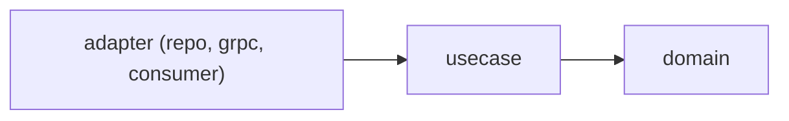

# Quy ước code NEO Mini

> **Mục đích:** Gom các quy tắc viết code của bài: khuôn service Go, giới hạn kích thước, tiền, kiểm quyền, CSDL, sự kiện, web, cấu hình, test, Git. Đây là nơi duy nhất định nghĩa quy tắc code, tiền và kiểm quyền.
>
> **Đối tượng đọc:** Người làm bài (trong lúc code), người chấm bài (khi rà checklist và hỏi đáp).
>
> **Nguồn:** mục 2, 4.2, 4.3, 4.4, 4.8, 10 của đề; thêm mục 4.5, 4.6, 4.7, 6.4, 8, 9 cho các quy tắc liên quan; quyết định Q1, Q19, Q20, Q21.

Phiên bản và hạ tầng: xem [tech-stack.md](tech-stack.md). Bảng và cột: xem [specs/data-model.md](specs/data-model.md). RPC, REST, mã lỗi: xem [specs/api-contract.md](specs/api-contract.md). Danh sách sự kiện: xem [specs/events.md](specs/events.md). Luật nghiệp vụ: xem [specs/business-rules.md](specs/business-rules.md).

## Cách đọc nhãn

| Cột | Ý nghĩa |
|---|---|
| Nhãn | **BẮT BUỘC** hoặc **NÊN** |
| Mục 10 | Nhóm checklist mục 10 chứa quy tắc này. "—" nghĩa là quy tắc chỉ có ở mục 4, 8 hoặc 9 của đề, không phải dòng checklist. |
| Lý do | Chỉ ghi khi đề có nêu lý do |

Theo mục 10, một dòng **BẮT BUỘC** của checklist bị trượt thì bài chưa đạt.

Theo Q19: quy tắc ở mục 4, 8, 9 của đề viết dạng mệnh lệnh nhưng không có trong checklist mục 10 vẫn gắn **BẮT BUỘC**, với "—" ở cột Mục 10. Chỉ hai dòng NÊN của mục 10 mới gắn **NÊN**.

## 1. Khuôn service Go

Ví dụ của đề cho `services/order/`:

```
services/order/
├── cmd/server/main.go     đọc cấu hình từ biến môi trường, nối dây, chạy server
├── internal/
│   ├── domain/            Order, trạng thái, quy tắc chuyển; KHÔNG import pgx, grpc, nats
│   ├── usecase/           mở giao dịch, gọi domain, ghi bảng + outbox, kiểm quyền
│   └── adapter/
│       ├── repo/          truy vấn sqlc
│       ├── grpc/          nhận request, kiểm đầu vào, gọi usecase, đổi lỗi sang mã gRPC
│       └── consumer/      nghe NATS, gọi usecase
├── migrations/            file SQL goose đánh số
├── queries/               file .sql cho sqlc
└── sqlc.yaml
```



| Quy tắc | Nhãn | Mục 10 |
|---|---|---|
| Phụ thuộc chỉ đi một chiều: `adapter → usecase → domain` | **BẮT BUỘC** | — |
| `domain` không import pgx, grpc, nats | **BẮT BUỘC** | Go |
| Adapter gRPC không chứa quy tắc nghiệp vụ | **BẮT BUỘC** | Go |
| Quy tắc chuyển trạng thái đơn viết ở tầng `domain` (bảng chuyển: [specs/business-rules.md](specs/business-rules.md)) | **BẮT BUỘC** | — |

> **Bổ sung ngoài đề (Q20):** `stock` theo đúng khuôn trên. `bff` giữ `cmd/server/main.go` và `internal/adapter/`, không có `domain/`, `repo/`, `migrations/`, `queries/`, `sqlc.yaml`, vì `bff` không có CSDL và không tính toán (mục 3 của đề).

## 2. Code Go

| Quy tắc | Nhãn | Mục 10 |
|---|---|---|
| `gofmt`, `go vet`, `go test ./...` sạch | **BẮT BUỘC** | Go |
| `context.Context` là tham số đầu của mọi hàm có I/O | **BẮT BUỘC** | — |
| Lỗi bọc bằng `fmt.Errorf("...: %w", err)` | **BẮT BUỘC** | — |
| Log bằng `log/slog` | **BẮT BUỘC** | — |
| Không `panic` ngoài `main` | **BẮT BUỘC** | — |
| Mọi lời gọi gRPC và NATS có timeout | **BẮT BUỘC** | Go |
| Goroutine có đường dừng khi tắt server (kể cả relay outbox, xem [specs/events.md](specs/events.md)) | **BẮT BUỘC** | Go |
| Tên rõ nghĩa; comment giải thích **vì sao**, không kể lại code; không để code bị comment (áp cho cả Go và web) | **NÊN** | Chung |

## 3. Giới hạn kích thước

| Giới hạn | Giá trị | Nhãn | Mục 10 |
|---|---|---|---|
| Độ dài file | ≤ 500 dòng | **BẮT BUỘC** | Chung |
| Độ dài hàm (mức của đề) | ≤ 60 dòng | **BẮT BUỘC** | Chung |
| Độ dài hàm Go (mức của dự án, bổ sung ngoài đề, Q21) | < 40 dòng | **BẮT BUỘC** | — |
| Số tham số của hàm | ≤ 5 | **BẮT BUỘC** | — |
| Độ lồng `if/for` | ≤ 4 cấp | **BẮT BUỘC** | — |
| Component React | ≤ 200 dòng | **BẮT BUỘC** | Chung |

Hàm Go viết < 40 dòng thì tự đạt mức ≤ 60 của đề. Giới hạn file giữ ≤ 500 dòng theo đề, không nới ra (Q21).

## 4. Tiền

Lý do chung: `0.1 + 0.2` trong số thực không bằng `0.3`; cộng nhiều dòng tiền sẽ lệch vài đồng.

| Tầng | Quy tắc | Nhãn | Mục 10 |
|---|---|---|---|
| Mọi tầng | Tiền không đi qua `float64` ở bất kỳ đâu | **BẮT BUỘC** | Go |
| CSDL | Cột tiền `NUMERIC(18,2)` kèm `currency_code CHAR(3)`; bài chỉ dùng `VND`. Cột cụ thể: [specs/data-model.md](specs/data-model.md) | **BẮT BUỘC** | — |
| Go domain | Dùng `int64` tính bằng xu (1 đồng = 100 xu) | **BẮT BUỘC** | — |
| Adapter | Đổi qua lại giữa `int64` xu và chuỗi `"1250000.00"` | **BẮT BUỘC** | — |
| Proto và JSON | Tiền là chuỗi thập phân kèm mã tiền tệ: `{ "amount": "1250000.00", "currencyCode": "VND" }` | **BẮT BUỘC** | — |
| Web | Hiển thị tiền qua một hàm `formatMoney()` duy nhất, kiểu `1.250.000 ₫`; không tự format rải rác | **BẮT BUỘC** | BFF và web |

Công thức, tính trong `domain` của service đơn:

```
line_amount  = quantity × unit_price
total_amount = tổng line_amount
```

Nguồn đơn giá và bên nào tính tổng tiền: xem [specs/business-rules.md](specs/business-rules.md), mục 8.

## 5. Kiểm quyền

| Quy tắc | Nhãn | Mục 10 |
|---|---|---|
| Kiểm quyền theo tên quyền (capability), không theo tên người hay tên vai trò | **BẮT BUỘC** | Go |
| Chặn tự duyệt ở usecase, không chỉ ẩn nút trên web | **BẮT BUỘC** | Sự kiện và nghiệp vụ |

```go
// Đúng
if caps.Has("order.approve") { ... }

// Sai
if user == "binh" { ... }
if role == "manager" { ... }
```

Người dùng mẫu, quyền của họ và luật "người lập không tự duyệt": xem [specs/business-rules.md](specs/business-rules.md). Quyền cần cho từng RPC và mã lỗi khi tự duyệt: xem [specs/api-contract.md](specs/api-contract.md).

## 6. CSDL

| Quy tắc | Nhãn | Mục 10 | Lý do |
|---|---|---|---|
| Mọi bảng có `tenant_id` bật `ENABLE` và `FORCE ROW LEVEL SECURITY` | **BẮT BUỘC** | CSDL | PostgreSQL tự lọc theo tenant, nên quên `WHERE tenant_id = ...` cũng không lộ dữ liệu; `FORCE` để áp cả với chủ bảng |
| Service chạy bằng vai trò thường `mini_app` (không phải superuser, không phải chủ bảng), không chạy bằng `postgres` | **BẮT BUỘC** | CSDL | Superuser luôn bỏ qua RLS, nên test chạy bằng `postgres` sẽ xanh dù chính sách sai |
| Migration chạy bằng vai trò khác (chủ bảng) | **BẮT BUỘC** | — | |
| `app.tenant_id` đặt bằng `set_config(..., true)` trong từng giao dịch, ngay sau `BEGIN`; không đặt cho cả kết nối | **BẮT BUỘC** | CSDL | Kết nối trong pool được dùng lại cho request của tenant khác |
| Mã nghiệp vụ chỉ mở giao dịch qua `db.InTx(ctx, func(tx pgx.Tx) error)`: lấy tenant từ `ctx`, mở giao dịch, đặt `app.tenant_id`, chạy hàm, rồi commit hoặc rollback | **BẮT BUỘC** | — | |
| Ngoại lệ duy nhất: relay dùng vai trò riêng `mini_relay` có `BYPASSRLS`, chỉ được cấp quyền trên bảng `outbox` | **BẮT BUỘC** | — | Relay đọc outbox của mọi tenant |
| Truy vấn qua sqlc, không ghép chuỗi SQL | **BẮT BUỘC** | CSDL | |
| Migration đã merge thì không sửa; muốn đổi thì thêm file mới | **BẮT BUỘC** | CSDL | |

Mẫu SQL cho chính sách RLS và `set_config`, hành vi khi chưa đặt tenant, quyền của từng vai trò: xem [specs/data-model.md](specs/data-model.md), mục 5 và 6.

## 7. Sự kiện và nghiệp vụ

| Quy tắc | Nhãn | Mục 10 | Lý do |
|---|---|---|---|
| Outbox ghi cùng giao dịch với thay đổi nghiệp vụ; không chỗ nào trong usecase gọi NATS | **BẮT BUỘC** | Sự kiện và nghiệp vụ | [specs/events.md](specs/events.md), mục 4 |
| Inbox ghi cùng giao dịch xử lý; `ack` sau khi commit | **BẮT BUỘC** | Sự kiện và nghiệp vụ | [specs/events.md](specs/events.md), mục 5 |
| Giữ hàng: khóa dòng (`FOR UPDATE`, theo thứ tự `sku`) trước khi đọc tồn; tất cả hoặc không gì cả | **BẮT BUỘC** | Sự kiện và nghiệp vụ | [specs/events.md](specs/events.md), mục 7 |
| Ràng buộc `CHECK` trên tồn chỉ là lưới an toàn cuối; không dựa vào nó để kiểm | **BẮT BUỘC** | — | [specs/events.md](specs/events.md), mục 7 |

Nguyên tắc đặt tên và nội dung sự kiện (gồm Q1), danh mục sự kiện, phong bì, relay, JetStream: xem [specs/events.md](specs/events.md). Luật giữ hàng tất cả hoặc không gì cả: xem [specs/business-rules.md](specs/business-rules.md), mục 7.

## 8. BFF và web

| Quy tắc | Nhãn | Mục 10 |
|---|---|---|
| BFF không có CSDL, không tính tổng, không tự quyết quyền | **BẮT BUỘC** | BFF và web |
| Trang không gọi `fetch` trực tiếp. Mọi lời gọi BFF nằm trong `web/src/lib/data/` (ví dụ `listOrders()`, `approveOrder()`); trang chỉ gọi các hàm này rồi truyền props xuống component | **BẮT BUỘC** | BFF và web |
| Web không tính toán nghiệp vụ: không tự cộng tổng tiền, không tự tính tồn khả dụng, không tự quyết ai được bấm Duyệt | **BẮT BUỘC** | — |
| Nút nào hiện là theo `allowedActions` do API trả | **BẮT BUỘC** | BFF và web |
| Next.js App Router, render phía server; `'use client'` chỉ đặt ở component có tương tác (form, nút) | **BẮT BUỘC** | — |
| Server Component mặc định, `'use client'` đặt sâu nhất có thể | **NÊN** | BFF và web |
| Giao diện tiếng Việt, chữ viết thẳng trong code | **BẮT BUỘC** | — |
| Không dùng màu hex hay `style=` rải rác; khai màu, khoảng cách một lần trong theme Tailwind rồi dùng lớp | **BẮT BUỘC** | — |

Hiển thị tiền qua `formatMoney()`: xem mục 4. Giới hạn component React ≤ 200 dòng: xem mục 3.

Màn web và trạng thái từng màn: xem [specs/web.md](specs/web.md).

## 9. Cấu hình

| Quy tắc | Nhãn | Mục 10 |
|---|---|---|
| Không commit mật khẩu, file `.env` | **BẮT BUỘC** | Chung |
| Cấu hình đọc từ biến môi trường (`cmd/server/main.go`) | **BẮT BUỘC** | Chung |

## 10. Test

| Quy tắc | Nhãn | Mục 10 |
|---|---|---|
| Tên test chứa mã AC, ví dụ `TestApprove_AC03_SelfApprovalDenied` | **BẮT BUỘC** | — |
| Test tích hợp đặt build tag `//go:build integration` (lệnh chạy: [../README.md](../README.md), mục 4) | **BẮT BUỘC** | — |
| Test tích hợp dùng CSDL riêng cho test (tạo mới rồi xóa), không đụng dữ liệu đang demo | **BẮT BUỘC** | — |

AC nào là unit test, AC nào là test tích hợp, và đối chứng âm cho AC-08: xem [specs/acceptance.md](specs/acceptance.md).

## 11. Git và nộp bài

| Quy tắc | Nhãn | Mục 10 |
|---|---|---|
| Commit nhỏ theo từng bước, không dồn một commit cuối ngày 4 | **BẮT BUỘC** | — (câu dẫn đầu mục 10) |
| Bài nộp ghi mã AC đã đạt và lệnh kiểm đã chạy, kèm kết quả thật | **BẮT BUỘC** | Chung |
| Giải thích được code mình nộp khi được hỏi; được dùng trợ lý AI nhưng phải giải thích được từng dòng (mục 8) | **BẮT BUỘC** | Chung |

## 12. Quyết định thiết kế

Buổi chấm sẽ hỏi 15–20 phút về code. Các câu trả lời dưới đây chỉ dùng lập luận có trong đề.

1. **Vì sao không gửi NATS ngay trong usecase?**
   Nếu ghi CSDL rồi mới gửi NATS mà máy chết giữa hai việc, dữ liệu đã đổi nhưng sự kiện mất. Nếu gửi trước rồi ghi CSDL lỗi, sự kiện kể một việc chưa xảy ra. Vì vậy sự kiện được ghi vào `outbox` trong cùng giao dịch, và relay gửi NATS sau (mục 4.5).

2. **Bỏ `FOR UPDATE` thì chuyện gì xảy ra?**
   Hai giao dịch chạy song song cùng đọc thấy tồn còn 1, cùng giữ, và tồn thành âm. AC-08 bắt buộc có đối chứng âm: tạm bỏ `FOR UPDATE` thì test phải đỏ (mục 4.7, mục 9).

3. **Vì sao khóa theo thứ tự `sku`?**
   Để hai giao dịch không chờ nhau vòng tròn (deadlock) (mục 4.7).

4. **Vì sao dùng `int64` xu thay vì `float64`?**
   `0.1 + 0.2` trong số thực không bằng `0.3`; cộng nhiều dòng tiền sẽ lệch vài đồng (mục 4.3).

5. **Vì sao `set_config` trong giao dịch chứ không đặt cho cả kết nối?**
   Kết nối trong pool được dùng lại cho request của tenant khác. Tham số `true` giới hạn giá trị trong giao dịch hiện tại (mục 4.4).

6. **Vì sao test bằng superuser cho kết quả xanh giả?**
   Superuser luôn bỏ qua RLS, nên test chạy bằng `postgres` vẫn xanh dù chính sách sai. Vì vậy service kết nối bằng vai trò thường `mini_app`, và AC-04 kiểm thêm ở mức SQL bằng `mini_app` (mục 4.4, mục 9).

7. **Vì sao inbox ghi cùng giao dịch và `ack` sau commit?**
   Relay có thể gửi xong rồi chết trước khi đánh dấu, nên một sự kiện có thể đến hai lần. Dòng inbox và việc nghiệp vụ cùng nằm trong một giao dịch, nên "chèn inbox không được dòng nào" đúng nghĩa "đã xử lý rồi". Chỉ `ack` sau khi commit; lỗi thì không `ack` để NATS gửi lại (mục 4.5, 4.6).
