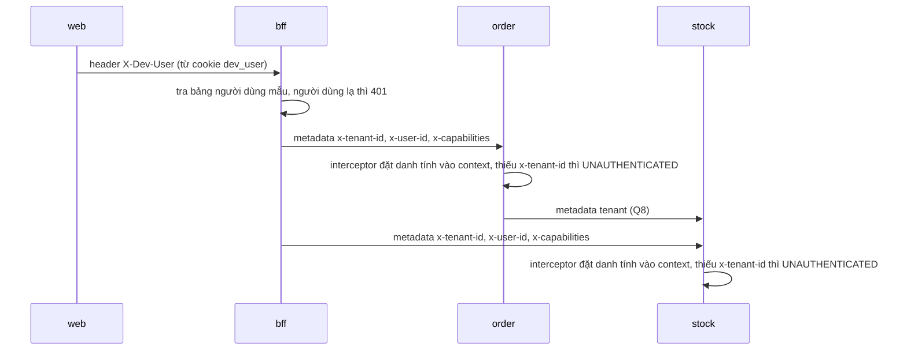

# Hợp đồng API NEO Mini

> **Mục đích:** Định nghĩa các RPC gRPC của `order` và `stock`, REST của BFF, mã lỗi, cách ánh xạ lỗi sang HTTP, và cách danh tính đi qua các tầng. Đây là nơi duy nhất định nghĩa RPC và REST.
>
> **Đối tượng đọc:** Người làm bài (khi viết proto, adapter gRPC, BFF, `web/src/lib/data/`), người chấm bài.
>
> **Nguồn:** mục 6.1, 6.2, 6.3 của đề (thêm mục 2 cho điều kiện chuyển trạng thái, mục 7 cho dữ liệu web cần); quyết định Q8, Q9, Q10, Q11, Q14, Q15, Q25–Q33, Q37.

Quy tắc tiền (dạng chuỗi, `formatMoney()`): xem [../conventions.md](../conventions.md), mục 4. Bảng và cột: xem [data-model.md](data-model.md). Trạng thái và luật nghiệp vụ: xem [business-rules.md](business-rules.md). Sự kiện: xem [events.md](events.md). Phiên bản Buf, gRPC: xem [../tech-stack.md](../tech-stack.md).

## 1. gRPC

| Service | RPC | Quyền cần | Ghi chú |
|---|---|---|---|
| `mini.order.v1.OrderService` | `CreateOrder(lines[{sku, quantity}])` | `order.create` | Gọi `StockService.GetItems` lấy giá; mã hàng không có thì `NOT_FOUND` |
| | `GetOrder(id)` | `order.create` hoặc `order.approve` | Trả kèm `allowed_actions` |
| | `ListOrders()` | `order.create` hoặc `order.approve` | Tối đa 50 đơn mới nhất, chưa cần phân trang |
| | `ApproveOrder(id)` | `order.approve` | Người lập tự duyệt: `PERMISSION_DENIED`, lý do `SELF_APPROVAL` |
| | `RejectOrder(id, reason)` | `order.approve` | |
| `mini.stock.v1.StockService` | `ListItems()` | Người dùng bất kỳ của tenant | Trả cả `available` (tồn khả dụng, công thức ở [business-rules.md](business-rules.md), mục 5) |
| | `GetItems(skus[])` | Gọi nội bộ | Chỉ service đơn gọi |

Ô "Quyền cần" của `ListOrders` trong đề ghi "như trên"; ở đây viết đầy đủ theo dòng `GetOrder`.

### `allowed_actions`

- Service đơn tính `allowed_actions` từ trạng thái, quyền và người gọi. Giá trị là `["APPROVE", "REJECT"]` hoặc `[]`.
- Suy ra từ bảng chuyển trạng thái ([business-rules.md](business-rules.md), mục 3): trả `["APPROVE", "REJECT"]` khi đơn ở `PENDING_APPROVAL`, người gọi có `order.approve` và không phải người lập. Mọi trường hợp khác trả `[]`.
- Web hiện nút theo trường này, không tự quyết ([../conventions.md](../conventions.md), mục 8).

### `GetItems` (Q8)

- BFF không gọi `GetItems`.
- Service đơn gọi `GetItems` khi tạo đơn, và truyền lại metadata tenant (mục 6) sang service kho.
- Không có cơ chế xác thực riêng cho "gọi nội bộ". Đây là quy ước của bài.

## 2. Request và response theo field

Tên field proto dùng snake_case, như `allowed_actions` của đề. Field tiền là chuỗi thập phân kèm mã tiền tệ ([../conventions.md](../conventions.md), mục 4).

| RPC | Request (theo đề) | Response |
|---|---|---|
| `CreateOrder` | `lines[{sku, quantity}]`; không có trường giá | Đơn vừa tạo (như `GetOrder`)* |
| `GetOrder` | `id` | Đơn, các dòng, `allowed_actions` |
| `ListOrders` | (không có) | Danh sách tối đa 50 đơn mới nhất* |
| `ApproveOrder` | `id` | Đơn sau khi chuyển trạng thái* |
| `RejectOrder` | `id`, `reason` | Đơn sau khi chuyển trạng thái* |
| `ListItems` | (không có) | Danh sách mặt hàng, mỗi mặt hàng có `available`* |
| `GetItems` | `skus[]` | Đơn giá của các mã hàng tìm thấy* |

Dấu `*`: đề không nêu response; field chốt theo Q25 (**bổ sung ngoài đề**) ở bảng dưới.

| Message | Field (Q25) | Lấy từ |
|---|---|---|
| Đơn | `id`, `code`, `status`, `created_by`, `decided_by`, `reject_reason`, `total_amount` (tiền), `lines[]`, `created_at`, `updated_at` | Cột `orders` |
| Dòng đơn | `sku`, `quantity`, `unit_price` (tiền), `line_amount` (tiền) | Cột `order_lines` |
| `GetOrder` | Đơn + `allowed_actions` | Đề |
| `CreateOrder`, `ApproveOrder`, `RejectOrder` | Đơn như `GetOrder` (cùng `allowed_actions`) | Màn `/orders/new` chỉ hiện tổng sau khi service trả về |
| `ListOrders` | `orders[]`, mỗi đơn có ít nhất `id`, `code`, `created_by`, `total_amount`, `status`; xếp theo `created_at` giảm dần | Màn `/orders`: mã, người lập, tổng tiền, trạng thái |
| Mặt hàng (`ListItems`) | `sku`, `name`, `unit_price` (tiền), `on_hand`, `reserved`, `available` | Cột `stock_items`; đề ghi "trả cả `available`" |
| Mặt hàng (`GetItems`) | `sku`, `unit_price` (tiền) | Cột `stock_items` |

| Quy tắc | Nguồn |
|---|---|
| `status` và `allowed_actions` là `string` trong proto, giữ nguyên giá trị như đề (`PENDING_APPROVAL`, `APPROVE`, `REJECT`…); không dùng enum proto. Lý do: enum theo `buf lint` mặc định phải có tiền tố (ví dụ `ORDER_STATUS_PENDING_APPROVAL`) nên tên sẽ lệch đề | Q26 (**bổ sung ngoài đề**) |
| `GetItems` chỉ trả các mã tìm thấy; usecase `CreateOrder` so khớp và trả `NOT_FOUND` cho mã không có | Q27 (**bổ sung ngoài đề**) |
| Adapter gRPC trả `INVALID_ARGUMENT` khi `lines` rỗng (đề nói "một hay nhiều dòng"), khi có `quantity <= 0`, khi một `sku` lặp lại trong cùng đơn, hoặc khi lý do từ chối sai độ dài | Q28 (**bổ sung ngoài đề**) |

## 3. Mã lỗi

| Mã gRPC | Khi nào |
|---|---|
| `INVALID_ARGUMENT` | Đầu vào sai |
| `UNAUTHENTICATED` | Thiếu danh tính |
| `PERMISSION_DENIED` | Thiếu quyền, tự duyệt |
| `NOT_FOUND` | Không tìm thấy |
| `FAILED_PRECONDITION` | Chuyển trạng thái sai |

Mã lý do (Q10). Chỉ hai mã có tên:

| Mã lý do | Đi kèm mã gRPC | Khi nào |
|---|---|---|
| `SELF_APPROVAL` | `PERMISSION_DENIED` | Người lập tự duyệt; cũng dùng khi người lập tự từ chối (Q30, **bổ sung ngoài đề**) |
| `INVALID_TRANSITION` | `FAILED_PRECONDITION` | Chuyển trạng thái không có trong bảng ([business-rules.md](business-rules.md), mục 3) |

- Lỗi khác chỉ có mã gRPC và message (Q10).
- Mã lý do gửi kèm trong chi tiết lỗi để BFF trả về cho web. Theo Q29 (**bổ sung ngoài đề**): service đơn đính message `ErrorDetail { string reason = 1; }` (khai trong `proto/mini/order/v1/`) vào status gRPC; BFF đọc `reason` từ chi tiết lỗi. Không dùng `google.rpc.ErrorInfo`, để khỏi thêm module `google.golang.org/genproto/googleapis/rpc` ngoài bảng phiên bản ([../tech-stack.md](../tech-stack.md), mục 7).
- Đơn của tenant khác không đọc được qua RLS, nên `GetOrder` trả `NOT_FOUND` như với id không tồn tại (theo AC-04, mục 9 của đề).
- Khi duyệt hoặc từ chối, thứ tự kiểm là: quyền → tự duyệt → chuyển trạng thái (Q31, **bổ sung ngoài đề**). Ví dụ: người lập duyệt đơn đang `REJECTED` nhận `SELF_APPROVAL`. AC-02, AC-03, AC-09 đều đúng với thứ tự này.
- Service đặt message tiếng Việt trong status gRPC; BFF chuyển nguyên (Q32, **bổ sung ngoài đề**). Ví dụ của đề: `"Bạn không thể tự duyệt đơn do mình lập"`.


## 4. Ánh xạ lỗi gRPC sang HTTP

| Mã gRPC | HTTP |
|---|---|
| `INVALID_ARGUMENT` | 400 |
| `UNAUTHENTICATED` | 401 |
| `PERMISSION_DENIED` | 403 |
| `NOT_FOUND` | 404 |
| `FAILED_PRECONDITION` | 409 |

Body lỗi luôn có `code` và `message` (Q14):

- Lỗi có mã lý do thì `code` là mã lý do.
- Lỗi không có mã lý do thì `code` là tên mã gRPC, ví dụ `"NOT_FOUND"` (**Q14, bổ sung ngoài đề**).

```json
{ "code": "SELF_APPROVAL", "message": "Bạn không thể tự duyệt đơn do mình lập" }
```

> **Gợi ý (ngoài đề):** Đề không ánh xạ các mã gRPC khác (ví dụ `DEADLINE_EXCEEDED`, `UNAVAILABLE`, `INTERNAL`). Có thể trả 500 cho các mã này, với `code` là tên mã gRPC theo Q14.

## 5. REST của BFF

| Phương thức, đường dẫn | Gọi tới |
|---|---|
| `GET /api/me` | Người dùng, tenant, quyền |
| `GET /api/orders` | `ListOrders` |
| `POST /api/orders` | `CreateOrder` |
| `GET /api/orders/{id}` | `GetOrder` |
| `POST /api/orders/{id}/approve` | `ApproveOrder` |
| `POST /api/orders/{id}/reject` | `RejectOrder` (body `{ "reason": "..." }`) |
| `GET /api/stock-items` | `ListItems` |

- JSON dùng camelCase. Ví dụ: `allowed_actions` → `allowedActions`, `unit_price` → `unitPrice`, `line_amount` → `lineAmount`, `total_amount` → `totalAmount`.
- Tiền: `{ "amount": "1250000.00", "currencyCode": "VND" }` ([../conventions.md](../conventions.md), mục 4).
- Body của `POST /api/orders` theo request `CreateOrder`: `{ "lines": [{ "sku": "BAN-01", "quantity": 2 }] }`.
- Client có gửi giá trong body thì BFF bỏ qua, không báo lỗi ([business-rules.md](business-rules.md), mục 8). Vì proto không có trường giá, BFF không được từ chối body có field lạ.

Response của `GET /api/me` (Q33, **bổ sung ngoài đề**): BFF trả lời từ bảng người dùng mẫu, không gọi gRPC. `userId` theo Q15, `tenantId` theo Q9.

```json
{ "userId": "binh", "tenantId": "11111111-1111-1111-1111-111111111111", "capabilities": ["order.create", "order.approve"] }
```

## 6. Danh tính đi qua các tầng



| Tầng | Mang danh tính bằng | Quy tắc |
|---|---|---|
| Web | Cookie `dev_user` | Lưu người dùng đã chọn; gửi header `X-Dev-User: binh` tới BFF |
| BFF | Bảng người dùng mẫu ([business-rules.md](business-rules.md), mục 4) | Người dùng lạ thì trả 401 |
| BFF → service | Metadata gRPC `x-tenant-id`, `x-user-id`, `x-capabilities` (cách nhau bằng dấu phẩy) | `x-user-id` là tên người dùng mẫu dạng chuỗi (Q15) |
| Service | Interceptor gRPC | Đọc metadata, đặt vào `context`; thiếu `x-tenant-id` thì `UNAUTHENTICATED` |
| order → stock | Metadata tenant | Service đơn truyền lại (Q8) |

Đây là cách làm tạm cho bài. Hệ thống thật đăng nhập qua Keycloak và kiểm token ở gateway.

## 7. Quy ước proto

| Quy tắc | Nhãn |
|---|---|
| Proto đặt ở `proto/mini/<service>/v1/` (`proto/mini/order/v1/`, `proto/mini/stock/v1/`) | **BẮT BUỘC** |
| `buf lint` sạch | **BẮT BUỘC** |
| Mã sinh commit vào `gen/go/` | **BẮT BUỘC** |

Nhãn theo Q19: đây là quy tắc mệnh lệnh ở mục 6.1, không có trong checklist mục 10.

Message `ErrorDetail` cho chi tiết lỗi: xem mục 3 (Q29).

> **Gợi ý (ngoài đề):** Với bộ luật mặc định của `buf lint`, mỗi RPC nên có message request và response riêng, đặt tên `<Rpc>Request`, `<Rpc>Response` (ví dụ `CreateOrderRequest`, `CreateOrderResponse`). Response của `CreateOrder`, `GetOrder`, `ApproveOrder`, `RejectOrder` có thể bọc chung một message đơn.

## 8. Mở rộng EX-01 (Q37, **bổ sung ngoài đề**)

Chỉ có khi làm EX-01. Không tính vào 7 RPC và 7 endpoint REST ở trên.

| Thành phần | Nội dung |
|---|---|
| RPC | `CancelOrder(id)` trong `mini.order.v1.OrderService`, quyền `order.approve`. Response như `ApproveOrder` |
| REST | `POST /api/orders/{id}/cancel` → `CancelOrder` |
| `allowed_actions` | Có thêm `"CANCEL"` khi đơn ở `RESERVED` và người gọi có `order.approve` |
| Lỗi | Hủy đơn không ở `RESERVED`: `FAILED_PRECONDITION`, lý do `INVALID_TRANSITION` |

Trạng thái `CANCELLED`: xem [business-rules.md](business-rules.md), mục 10. Sự kiện phát ra khi hủy: xem [events.md](events.md), mục 2.
