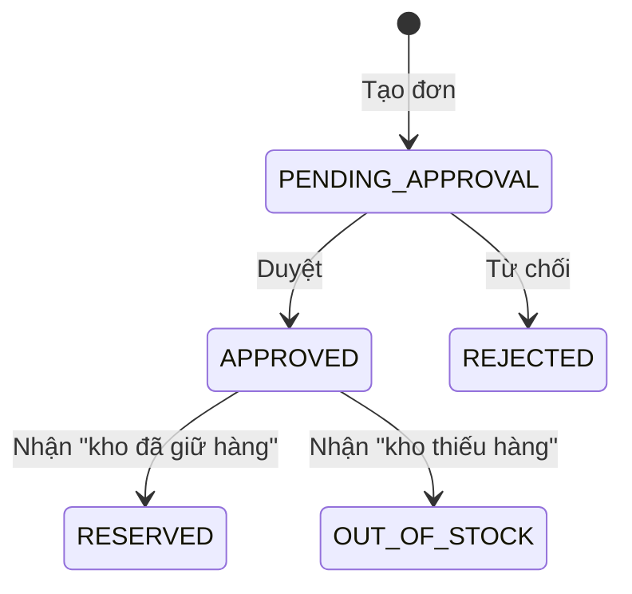

# Luật nghiệp vụ NEO Mini

> **Mục đích:** Định nghĩa luồng nghiệp vụ, trạng thái đơn, bảng chuyển trạng thái, người dùng mẫu, dữ liệu mẫu và các luật nghiệp vụ cốt lõi.
>
> **Đối tượng đọc:** Người làm bài (khi viết `domain` và `usecase`), người chấm bài.
>
> **Nguồn:** mục 1, 2 của đề (thêm mục 6.1 cho quyền tạo đơn, mục 6.4 cho sự kiện đến muộn); quyết định Q9, Q11, Q16, Q17, Q37, Q39.

Quy tắc tiền và kiểm quyền: xem [../conventions.md](../conventions.md). Bảng và cột: xem [data-model.md](data-model.md). RPC và mã lỗi: xem [api-contract.md](api-contract.md). Sự kiện: xem [events.md](events.md).

## 1. Luồng nghiệp vụ

Một công ty bán hàng có kho. Luồng chính:

1. Nhân viên bán **tạo đơn** gồm một hay nhiều dòng (mã hàng, số lượng). Đơn tạo xong ở trạng thái `PENDING_APPROVAL`. Đơn giá lấy từ service kho lúc tạo đơn (mục 8).
2. **Người khác** có quyền duyệt bấm **Duyệt** hoặc **Từ chối**. Người lập đơn không tự duyệt được, kể cả khi người đó có quyền duyệt.
3. Đơn được duyệt thì service đơn phát sự kiện "đơn đã duyệt". Service kho nhận sự kiện và **giữ hàng cho cả đơn** theo luật tất cả hoặc không gì cả (mục 7).
4. Kho phát sự kiện kết quả. Service đơn nhận và chuyển đơn sang `RESERVED` hoặc `OUT_OF_STOCK`.
5. Tổng tiền đơn do service đơn tính. BFF và web chỉ hiển thị.

Tên và nội dung các sự kiện ở bước 3, 4: xem [events.md](events.md).

## 2. Trạng thái đơn

| Trạng thái | Nghĩa |
|---|---|
| `PENDING_APPROVAL` | Chờ duyệt (trạng thái lúc tạo) |
| `APPROVED` | Đã duyệt, đang chờ kho trả lời |
| `RESERVED` | Kho đã giữ đủ hàng |
| `OUT_OF_STOCK` | Kho không đủ hàng, không giữ dòng nào |
| `REJECTED` | Bị từ chối |

## 3. Chuyển trạng thái

| # | Hành động | Từ | Sang | Điều kiện |
|---|---|---|---|---|
| 0 | Tạo đơn | (đơn mới) | `PENDING_APPROVAL` | Có quyền `order.create` |
| 1 | Duyệt | `PENDING_APPROVAL` | `APPROVED` | Có quyền `order.approve` và không phải người lập |
| 2 | Từ chối | `PENDING_APPROVAL` | `REJECTED` | Có quyền `order.approve` và không phải người lập; lý do hợp lệ (mục 9) |
| 3 | Nhận "kho đã giữ hàng" | `APPROVED` | `RESERVED` | — |
| 4 | Nhận "kho thiếu hàng" | `APPROVED` | `OUT_OF_STOCK` | — |

Dòng 0 không nằm trong bảng chuyển của đề. Nó lấy từ bảng trạng thái ("trạng thái lúc tạo") và mục 6.1 (`CreateOrder` cần `order.create`). Các dòng 1 đến 4 khớp bảng chuyển của đề; ở dòng 2, chữ "Như trên" của đề được viết đầy đủ.

| Quy tắc | Nhãn |
|---|---|
| Chuyển trạng thái không có trong bảng thì báo lỗi `INVALID_TRANSITION` (mã gRPC: xem [api-contract.md](api-contract.md)) | **BẮT BUỘC** |
| Quy tắc chuyển trạng thái viết ở tầng `domain` | **BẮT BUỘC** |

Sự kiện kho đến khi đơn không còn ở `APPROVED` không báo `INVALID_TRANSITION` mà được xử lý theo [events.md](events.md), mục 9.

Sơ đồ có đúng 5 mũi tên, ứng với dòng 0 đến 4 của bảng. Đề không nói trạng thái nào là trạng thái cuối, nên sơ đồ không vẽ mũi tên về `[*]`.

## 4. Người dùng mẫu và dữ liệu mẫu

Chưa làm đăng nhập thật. Có bốn người dùng cố định, mỗi người thuộc một tenant và có một số quyền (capability):

| Người dùng | Tenant | Quyền |
|---|---|---|
| `an` | A | `order.create` |
| `binh` | A | `order.create`, `order.approve` |
| `chi` | A | `order.approve` |
| `dung` | B | `order.create`, `order.approve` |

| Tenant | UUID (Q9) | Mặt hàng mẫu |
|---|---|---|
| A | `11111111-1111-1111-1111-111111111111` | 3 mặt hàng, trong đó một mặt hàng chỉ còn 1 cái (để thử hai đơn tranh nhau) |
| B | `22222222-2222-2222-2222-222222222222` | 2 mặt hàng |

- Kiểm quyền theo tên quyền, không theo tên người hay tên vai trò. Quy tắc và ví dụ: xem [../conventions.md](../conventions.md), mục 5.
- Theo Q16, dữ liệu mẫu chỉ gồm tenant và mặt hàng, không có đơn.
- Cách BFF dùng bảng người dùng này: xem [api-contract.md](api-contract.md), mục 6.

Mặt hàng mẫu (Q39, **bổ sung ngoài đề**). Đề không cho mã hàng, tên, đơn giá hay số tồn; mã duy nhất có trong đề là `BAN-01`, ở phong bì mẫu.

| Tenant | `sku` | `name` | `unit_price` | `on_hand` | `reserved` |
|---|---|---|---|---|---|
| A | `BAN-01` | Bàn làm việc | 1.250.000 ₫ | 10 | 0 |
| A | `GHE-01` | Ghế xoay | 850.000 ₫ | 20 | 0 |
| A | `DEN-01` | Đèn bàn | 320.000 ₫ | 1 | 0 |
| B | `BAN-01` | Bàn họp | 2.500.000 ₫ | 5 | 0 |
| B | `TU-01` | Tủ hồ sơ | 1.800.000 ₫ | 3 | 0 |

- `currency_code` của mọi mặt hàng là `VND`.
- `DEN-01` của tenant A là mặt hàng "chỉ còn 1 cái", dùng cho AC-08.
- `BAN-01` có ở cả hai tenant (khóa chính `(tenant_id, sku)`) để thử cách ly tenant.

## 5. Ba quy tắc hay sai nhất

| # | Quy tắc | Nhãn | Kỹ thuật thực hiện |
|---|---|---|---|
| 1 | Không vượt số khả dụng: **Tồn khả dụng = tồn thực tế − đang giữ** (`available = on_hand − reserved`). Không bao giờ để "đang giữ" lớn hơn "tồn thực tế" | **BẮT BUỘC** | [events.md](events.md), mục 7; ràng buộc `CHECK`: [data-model.md](data-model.md), mục 3 |
| 2 | Tiền không dùng số thực | **BẮT BUỘC** | [../conventions.md](../conventions.md), mục 4 |
| 3 | Người lập không tự duyệt, kể cả khi có quyền `order.approve` | **BẮT BUỘC** | Chặn ở usecase: [../conventions.md](../conventions.md), mục 5; mã lỗi: [api-contract.md](api-contract.md) |

## 6. Hiển thị

Web chỉ hiển thị, không tính toán nghiệp vụ. Quy tắc cụ thể: xem [../conventions.md](../conventions.md), mục 8.

## 7. Giữ hàng: tất cả hoặc không gì cả

| Quy tắc | Nhãn |
|---|---|
| Kho giữ hàng cho **cả đơn**: đủ hàng cho mọi dòng thì giữ hết; thiếu một dòng thì không giữ dòng nào | **BẮT BUỘC** |
| Giữ được thì đơn sang `RESERVED`; không giữ được thì đơn sang `OUT_OF_STOCK` | **BẮT BUỘC** |

Kỹ thuật khóa dòng khi giữ hàng: xem [events.md](events.md), mục 7.

## 8. Đơn giá và tổng tiền

| Quy tắc | Nhãn |
|---|---|
| Đơn giá lấy từ service kho lúc tạo đơn | **BẮT BUỘC** |
| Client không gửi giá; có gửi cũng bị bỏ qua | **BẮT BUỘC** |
| Tổng tiền đơn do service đơn tính; BFF và web chỉ hiển thị | **BẮT BUỘC** |

Công thức `line_amount`, `total_amount`: xem [../conventions.md](../conventions.md), mục 4.

## 9. Lý do từ chối

| Quy tắc | Nhãn | Nguồn |
|---|---|---|
| Lý do dài 10–500 ký tự | **BẮT BUỘC** | Mục 2 của đề |
| Đếm theo ký tự Unicode (rune), không theo byte | **BẮT BUỘC** | Q11 |
| Đếm rune nguyên trạng, không chuẩn hóa NFC/NFD trước khi đếm | **BẮT BUỘC** | Q17 (bổ sung ngoài đề) |

Mã lỗi khi lý do sai độ dài: xem [api-contract.md](api-contract.md).

## 10. Mở rộng EX-01: hủy đơn (Q37, **bổ sung ngoài đề**)

Chỉ có khi làm EX-01. Phần này không thuộc bảng trạng thái ở mục 2, bảng chuyển ở mục 3 hay sơ đồ ở mục 3.

| Trạng thái thêm | Nghĩa |
|---|---|
| `CANCELLED` | Đơn đã giữ hàng bị hủy; kho nhả lượng đã giữ |

| Hành động | Từ | Sang | Điều kiện |
|---|---|---|---|
| Hủy | `RESERVED` | `CANCELLED` | Có quyền `order.approve` |

Hủy không phải tự duyệt, nên không chặn người lập. RPC, REST và `allowed_actions`: xem [api-contract.md](api-contract.md), mục 8. Sự kiện và bước nhả hàng của kho (bước bù trừ): xem [events.md](events.md), mục 2.
