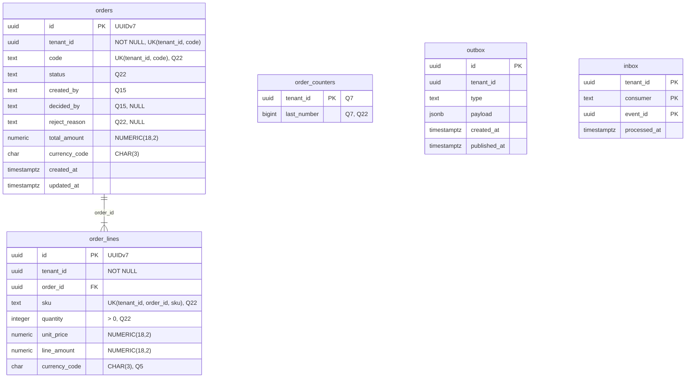
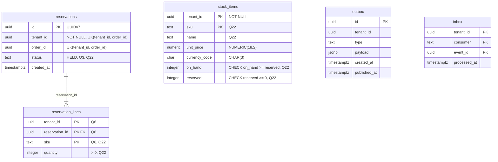

# Mô hình dữ liệu NEO Mini

> **Mục đích:** Định nghĩa các bảng, cột, ràng buộc của hai schema `mini_order` và `mini_stock`, cùng chính sách RLS và vai trò CSDL. Đây là nơi duy nhất định nghĩa bảng và cột.
>
> **Đối tượng đọc:** Người làm bài (khi viết migration, query sqlc), người chấm bài.
>
> **Nguồn:** mục 4.4, 4.5, 4.6, 4.7, 5 của đề; quyết định Q3, Q5, Q6, Q7, Q12, Q15, Q18, Q22, Q23, Q24, Q37, Q41.

Quy tắc tiền: xem [../conventions.md](../conventions.md), mục 4. Quy tắc CSDL và nhãn BẮT BUỘC: xem [../conventions.md](../conventions.md), mục 6. Giá trị trạng thái đơn: xem [business-rules.md](business-rules.md). Cách dùng `outbox`/`inbox` và relay: xem [events.md](events.md).

## Cách đọc cột "Nguồn" và "Kiểu"

| Ghi chú | Ý nghĩa |
|---|---|
| `đề` | Lấy từ mục 4.x hoặc 5 của đề |
| `Qn` | Lấy từ quyết định Qn trong `AGENTS.md`; nếu là **bổ sung ngoài đề** thì ghi rõ |
| Kiểu có dấu `*` | Đề không nêu kiểu; kiểu và `NOT NULL` chốt theo Q22 (**bổ sung ngoài đề**) |

## 1. Nguyên tắc chung

| Nguyên tắc | Nguồn |
|---|---|
| Mỗi bảng nghiệp vụ có cột `tenant_id UUID NOT NULL` | đề, mục 4.4 |
| Khóa chính UUIDv7 (cho các bảng có cột `id`) | đề, mục 5 |
| Thời gian kiểu `timestamptz`, lưu UTC | đề, mục 5 |
| Kiểu cột tiền theo quy tắc tiền ở [../conventions.md](../conventions.md), mục 4 | đề, mục 4.3 |
| Mọi bảng bật RLS (mục 5 bên dưới); relay dùng vai trò `BYPASSRLS` (mục 6) | đề, mục 5 |
| Một máy chủ PostgreSQL, hai schema `mini_order` và `mini_stock` | Q18 (bổ sung ngoài đề) |

Bảng có khóa chính không phải UUIDv7: `stock_items` (đề), `reservation_lines` (Q6), `inbox` (đề), `order_counters` (Q7).

> **Bổ sung ngoài đề (Q22):** Đề chỉ nêu kiểu của `tenant_id`, cột tiền, `currency_code`, cột thời gian và hai bảng `outbox`, `inbox`. Các cột còn lại: mã và tên dạng `text`; số lượng dạng `integer`; `last_number` dạng `bigint`. Mọi cột `NOT NULL`, trừ `decided_by` và `reject_reason` (để `NULL` khi đơn chưa được quyết định).

## 2. Schema `mini_order`

### `orders`

| Cột | Kiểu | Ràng buộc | Nguồn |
|---|---|---|---|
| `id` | `uuid` | Khóa chính, UUIDv7 | đề |
| `tenant_id` | `uuid` | `NOT NULL` | đề |
| `code` | `text`* | Dạng `DH-000001`; `UNIQUE (tenant_id, code)` | đề |
| `status` | `text`* | Một trong 5 trạng thái ở [business-rules.md](business-rules.md) | đề |
| `created_by` | `text` | Tên người dùng mẫu (`an`, `binh`…) | đề; kiểu theo Q15 |
| `decided_by` | `text` | `NULL`* khi chưa duyệt hay từ chối | đề; kiểu theo Q15 |
| `reject_reason` | `text`* | `NULL`* khi không bị từ chối | đề |
| `total_amount` | `NUMERIC(18,2)` | | đề |
| `currency_code` | `CHAR(3)` | | đề |
| `created_at` | `timestamptz` | | đề |
| `updated_at` | `timestamptz` | | đề |

### `order_lines`

| Cột | Kiểu | Ràng buộc | Nguồn |
|---|---|---|---|
| `id` | `uuid` | Khóa chính, UUIDv7 | đề |
| `tenant_id` | `uuid` | `NOT NULL` | đề |
| `order_id` | `uuid` | Trỏ tới `orders.id` | đề |
| `sku` | `text`* | `UNIQUE (tenant_id, order_id, sku)` | đề |
| `quantity` | `integer`* | `quantity > 0` | đề |
| `unit_price` | `NUMERIC(18,2)` | | đề |
| `line_amount` | `NUMERIC(18,2)` | | đề |
| `currency_code` | `CHAR(3)` | | **Q5, bổ sung ngoài đề** |

> **Bổ sung ngoài đề (Q5):** Bảng `order_lines` ở mục 5 của đề không có `currency_code`, nhưng mục 4.3 bắt cột tiền đi kèm `currency_code CHAR(3)`. `order_lines` có hai cột tiền (`unit_price`, `line_amount`), nên Q5 thêm cột này.

### `order_counters` (**Q7, bổ sung ngoài đề**)

Bảng đếm để sinh `orders.code` theo từng tenant.

| Cột | Kiểu | Ràng buộc | Nguồn |
|---|---|---|---|
| `tenant_id` | `uuid` | Khóa chính, `NOT NULL` | Q7 |
| `last_number` | `bigint`* | Số đã cấp gần nhất | Q7 |

- Trong cùng giao dịch tạo đơn: `INSERT ... ON CONFLICT (tenant_id) DO UPDATE SET last_number = last_number + 1 RETURNING last_number`. Lệnh này khóa dòng đếm của tenant tới hết giao dịch, như `FOR UPDATE`, và không lỗi khóa chính khi hai đơn đầu tiên của tenant tạo cùng lúc. Rồi tạo `code` = `DH-` + số đệm đủ 6 chữ số (ví dụ `DH-000001`).
- Không dùng `MAX()+1`.
- Bảng này bật RLS như mọi bảng khác.

> **Bổ sung ngoài đề (Q7):** Đề có `code` dạng `DH-000001` và `UNIQUE (tenant_id, code)`, nhưng không nói cách sinh mã. Q7 chọn bảng đếm theo tenant, vì với `MAX()+1`, hai giao dịch song song sẽ lấy cùng một số và vi phạm `UNIQUE (tenant_id, code)`.

### `outbox`, `inbox`

DDL và giá trị `inbox.consumer` ở mục 4 bên dưới.

### Sơ đồ ER `mini_order`



`order_counters`, `outbox`, `inbox` không có quan hệ khóa ngoại với bảng khác nên đứng riêng trong sơ đồ.

## 3. Schema `mini_stock`

### `stock_items`

| Cột | Kiểu | Ràng buộc | Nguồn |
|---|---|---|---|
| `tenant_id` | `uuid` | `NOT NULL`; khóa chính `(tenant_id, sku)` | đề |
| `sku` | `text`* | Khóa chính `(tenant_id, sku)` | đề |
| `name` | `text`* | | đề |
| `unit_price` | `NUMERIC(18,2)` | | đề |
| `currency_code` | `CHAR(3)` | | đề |
| `on_hand` | `integer`* | `CHECK (reserved >= 0 AND on_hand >= reserved)` | đề, mục 4.7 |
| `reserved` | `integer`* | Như trên | đề, mục 4.7 |

Ràng buộc `CHECK` là lưới an toàn cuối, không dùng để kiểm tồn. Quy tắc: xem [../conventions.md](../conventions.md), mục 7.

### `reservations`

| Cột | Kiểu | Ràng buộc | Nguồn |
|---|---|---|---|
| `id` | `uuid` | Khóa chính, UUIDv7 | đề |
| `tenant_id` | `uuid` | `NOT NULL`; `UNIQUE (tenant_id, order_id)` | đề |
| `order_id` | `uuid` | `UNIQUE (tenant_id, order_id)`; mang `orders.id` của service đơn | đề |
| `status` | `text`* | Chỉ có `HELD` | đề; Q3 |
| `created_at` | `timestamptz` | | đề |

Theo Q3, `RELEASED` chỉ xuất hiện nếu làm EX-01 và được ghi là phần mở rộng. Cách kho đổi sang `RELEASED`: xem [events.md](events.md), mục 2 (Q37).

### `reservation_lines`

| Cột | Kiểu | Ràng buộc | Nguồn |
|---|---|---|---|
| `tenant_id` | `uuid` | `NOT NULL`; khóa chính `(tenant_id, reservation_id, sku)` | đề; khóa: **Q6, bổ sung ngoài đề** |
| `reservation_id` | `uuid` | Trỏ tới `reservations.id`; thuộc khóa chính | đề; khóa: **Q6, bổ sung ngoài đề** |
| `sku` | `text`* | Thuộc khóa chính | đề; khóa: **Q6, bổ sung ngoài đề** |
| `quantity` | `integer`* | `quantity > 0` | đề |

### `outbox`, `inbox`

DDL và giá trị `inbox.consumer` ở mục 4 bên dưới.

### Sơ đồ ER `mini_stock`



`reservations.order_id` mang id của đơn bên schema `mini_order`. Hai schema thuộc hai service, nên sơ đồ không vẽ quan hệ qua schema. `reservation_lines.sku` cũng không vẽ quan hệ tới `stock_items`, vì đề không nêu khóa ngoại này.

> **Gợi ý (ngoài đề):** Đề không nói có khóa ngoại hay không. Có thể đặt khóa ngoại cho hai quan hệ cùng schema là `order_lines.order_id → orders.id` và `reservation_lines.reservation_id → reservations.id`. Không đặt khóa ngoại qua schema.

## 4. DDL `outbox` và `inbox`

Mỗi schema có một bảng `outbox` và một bảng `inbox` riêng. DDL chép đúng mục 4.5, 4.6 của đề:

```sql
CREATE TABLE outbox (
  id           uuid PRIMARY KEY,          -- = id của sự kiện (UUIDv7)
  tenant_id    uuid NOT NULL,
  type         text NOT NULL,             -- tên sự kiện, cũng là subject NATS
  payload      jsonb NOT NULL,            -- cả phong bì sự kiện
  created_at   timestamptz NOT NULL DEFAULT now(),
  published_at timestamptz
);
```

```sql
CREATE TABLE inbox (
  tenant_id    uuid NOT NULL,
  consumer     text NOT NULL,             -- ví dụ 'stock.reserve'
  event_id     uuid NOT NULL,
  processed_at timestamptz NOT NULL DEFAULT now(),
  PRIMARY KEY (tenant_id, consumer, event_id)
);
```

Giá trị `inbox.consumer` (Q12):

| Schema | `consumer` |
|---|---|
| `mini_stock` | `stock.reserve` |
| `mini_order` | `order.reservation_held` |
| `mini_order` | `order.reservation_failed` |
| `mini_stock` | `stock.release` (chỉ khi làm EX-01, Q37, **bổ sung ngoài đề**) |

Tên durable consumer JetStream tương ứng, phong bì sự kiện, vòng lặp relay và các bước xử lý inbox: xem [events.md](events.md).

## 5. Row Level Security

Áp cho mọi bảng ở mục 2, 3, 4. Mẫu của đề cho bảng `orders`:

```sql
ALTER TABLE orders ENABLE ROW LEVEL SECURITY;
ALTER TABLE orders FORCE ROW LEVEL SECURITY;   -- áp cả với chủ bảng
CREATE POLICY tenant_isolation ON orders
  USING      (tenant_id = current_setting('app.tenant_id')::uuid)
  WITH CHECK (tenant_id = current_setting('app.tenant_id')::uuid);
```

Đặt tenant ngay sau `BEGIN` của từng giao dịch:

```sql
SELECT set_config('app.tenant_id', $1, true);  -- true = chỉ trong giao dịch này
```

Ba điều hay sai (nhãn và lý do: [../conventions.md](../conventions.md), mục 6):

1. Service phải kết nối bằng vai trò thường `mini_app`, không phải superuser hay chủ bảng (mục 6).
2. Đặt tenant bằng `set_config(..., true)` trong từng giao dịch, không đặt cho cả kết nối.
3. Chưa đặt `app.tenant_id` thì `current_setting` báo lỗi. Đề coi đây là điều mong muốn: quên đặt tenant thì truy vấn hỏng, không lộ dữ liệu. Kiểm thực tế trên `postgres:18.6`: nếu kết nối từng dùng `set_config(..., true)`, biến còn lại dưới dạng chuỗi rỗng, nên lỗi đổi thành `invalid input syntax for type uuid: ""`. Truy vấn vẫn hỏng, không lộ dữ liệu.

Mã nghiệp vụ mở giao dịch qua `db.InTx(ctx, func(tx pgx.Tx) error)`. Quy tắc: xem [../conventions.md](../conventions.md), mục 6. Gói: xem [../tech-stack.md](../tech-stack.md), mục 6.

## 6. Vai trò CSDL

| Vai trò | Dùng bởi | Quyền |
|---|---|---|
| `mini_app` | Service `order` và `stock` khi chạy | Vai trò thường: không phải superuser, không phải chủ bảng; chịu RLS |
| `mini_owner` (tên: **Q23, bổ sung ngoài đề**) | goose khi chạy migration | Chủ bảng; không phải superuser |
| `mini_relay` | Relay outbox trong mỗi service | `BYPASSRLS`; chỉ được cấp quyền trên bảng `outbox` |

- Đề chỉ nói migration chạy bằng "vai trò khác (chủ bảng)". Q23 đặt tên `mini_owner` và không dùng `postgres`.
- Theo Q41 (**bổ sung ngoài đề**): `deploy/initdb/01-roles.sh` tạo ba vai trò và CSDL `mini` thuộc `mini_owner`. `mini_owner` có thêm `CREATEDB` để test tích hợp tự tạo CSDL riêng. Schema do migration tạo; bảng version goose là `goose_mini_order` và `goose_mini_stock`.
- Theo Q24 (**bổ sung ngoài đề**), hai service dùng chung `mini_app`, nên `mini_app` có quyền trên cả hai schema. Việc mỗi service chỉ đọc schema của mình dựa vào code, không dựa vào CSDL.

> **Gợi ý (ngoài đề):** Đề không liệt kê quyền cụ thể. Có thể cấp cho `mini_app` quyền `SELECT`, `INSERT`, `UPDATE` trên các bảng nghiệp vụ, `outbox`, `inbox`. Cấp cho `mini_relay` quyền `SELECT`, `UPDATE` trên `outbox`, đủ cho vòng lặp relay ở mục 4.5 của đề.
