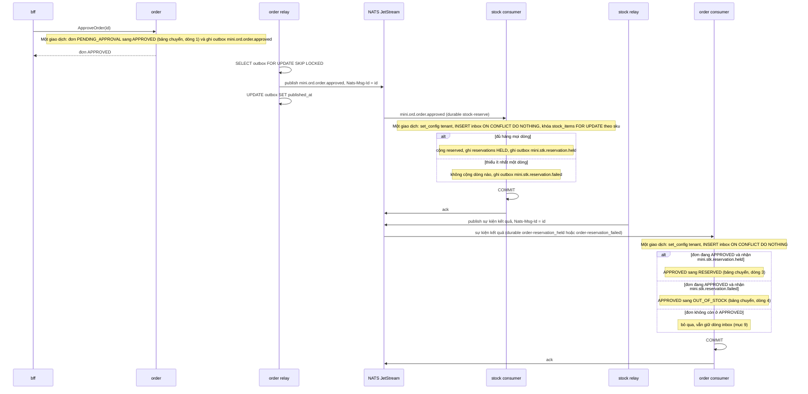

# Sự kiện NEO Mini

> **Mục đích:** Định nghĩa sự kiện giữa `order` và `stock`: quy ước đặt tên, danh mục, phong bì, cách phát bằng outbox, cách nhận bằng inbox, JetStream, và cách giữ hàng khi nhận sự kiện. Đây là nơi duy nhất định nghĩa sự kiện.
>
> **Đối tượng đọc:** Người làm bài (ngày 3: outbox, relay, inbox, giữ hàng), người chấm bài.
>
> **Nguồn:** mục 4.5, 4.6, 4.7, 6.4 của đề (thêm mục 9 cho EX-01); quyết định Q1, Q3, Q12, Q19, Q37.

DDL `outbox`, `inbox`, bảng `stock_items`, ràng buộc `CHECK`, vai trò `mini_relay`: xem [data-model.md](data-model.md). Nhãn checklist của outbox, inbox, giữ hàng: xem [../conventions.md](../conventions.md), mục 7. Trạng thái đơn và bảng chuyển: xem [business-rules.md](business-rules.md).

## 1. Nguyên tắc

| Quy tắc | Nhãn | Lý do |
|---|---|---|
| Tên sự kiện theo `mini.<service>.<thực thể>.<động từ quá khứ>`, với `<service>` viết tắt: `ord` = order, `stk` = stock (Q1) | **BẮT BUỘC** | Đề không nêu |
| Sự kiện kể việc **đã xảy ra**, không ra lệnh. Đúng: `order.approved`; sai: `reserve_stock` | **BẮT BUỘC** | Đề không nêu |
| Sự kiện **không mang tiền** | **BẮT BUỘC** | Bên nào cần số tiền thì hỏi service sở hữu số đó |
| Mã nghiệp vụ không bao giờ gọi NATS trực tiếp; sự kiện đi qua outbox (mục 4) | **BẮT BUỘC** | Xem mục 4 |

Nhãn theo Q19: các quy tắc mệnh lệnh ở mục 4.5 và 6.4, không có dòng riêng trong checklist mục 10.

Quy ước của đề viết `<service>`, trong khi service tên là `order`, `stock` mà sự kiện dùng `ord`, `stk`. Q1 chốt hiểu `<service>` là tên viết tắt, vì đề dùng đúng các tên viết tắt này ở bảng mục 6.4, phong bì mẫu và AC-07, và không có chỗ nào dùng `mini.order.*` hay `mini.stock.*`.

## 2. Danh mục sự kiện

| Sự kiện | Phát | Nghe | `data` |
|---|---|---|---|
| `mini.ord.order.approved` | order | stock | `orderId`, `lines[{sku, quantity}]` |
| `mini.stk.reservation.held` | stock | order | `orderId`, `reservationId` |
| `mini.stk.reservation.failed` | stock | order | `orderId`, `shortSkus[]` |

`ord` = order, `stk` = stock (Q1).

Sự kiện mở rộng, chỉ có khi làm EX-01 ([acceptance.md](acceptance.md), mục 5). Không tính vào 3 sự kiện ở trên.

| Sự kiện | Phát | Nghe | `data` |
|---|---|---|---|
| `mini.ord.order.cancelled` | order | stock | `orderId` (Q37, **bổ sung ngoài đề**) |

Theo Q37: `data` chỉ có `orderId`, vì sự kiện không mang tiền và kho tìm được phiếu giữ hàng qua `UNIQUE (tenant_id, order_id)` của `reservations`. Kho xử lý sự kiện này như mục 7: khóa `stock_items` `FOR UPDATE` theo `sku`, trừ `reserved` theo `reservation_lines`, đổi `reservations.status` sang `RELEASED`, tất cả trong cùng giao dịch với inbox. Không có sự kiện trả lời.

## 3. Phong bì

Phong bì là toàn bộ nội dung cột `payload` của `outbox`. Mẫu của đề:

```json
{
  "id": "0192f0c4-7a1e-7c3a-9b1d-4f2e8a6c1d00",
  "type": "mini.ord.order.approved",
  "source": "order",
  "tenantId": "11111111-1111-1111-1111-111111111111",
  "correlationId": "<orderId>",
  "causationId": null,
  "occurredAt": "2026-10-26T03:15:00Z",
  "schemaVersion": 1,
  "data": { "orderId": "...", "lines": [{ "sku": "BAN-01", "quantity": 2 }] }
}
```

| Trường | Ý nghĩa |
|---|---|
| `id` | Id của sự kiện (UUIDv7). Bằng `outbox.id`; relay gửi giá trị này trong header `Nats-Msg-Id`; bên nhận ghi vào `inbox.event_id` |
| `type` | Tên sự kiện (mục 2), cũng là subject NATS |
| `source` | Service phát (cột "Phát" ở mục 2), ví dụ `"order"` |
| `tenantId` | Tenant của sự kiện. Bên nhận đặt `app.tenant_id` bằng giá trị này (mục 5, bước 1) |
| `correlationId` | `= orderId` cho cả hành trình |
| `causationId` | `= id` của sự kiện gây ra sự kiện này. Mẫu của đề để `null` cho `mini.ord.order.approved`, vì sự kiện này không do sự kiện nào gây ra |
| `occurredAt` | Thời điểm xảy ra, dạng UTC như mẫu (`...Z`) |
| `schemaVersion` | Phiên bản lược đồ của sự kiện; mẫu của đề dùng `1` |
| `data` | Nội dung riêng của từng sự kiện, theo cột `data` ở mục 2 |

Ví dụ: sự kiện `mini.stk.reservation.held` do `mini.ord.order.approved` gây ra có `causationId` bằng `id` của `mini.ord.order.approved`, còn `correlationId` vẫn là `orderId`.

## 4. Phát sự kiện bằng outbox

**Vấn đề:**
- Ghi CSDL rồi mới gửi NATS, mà máy chết giữa hai việc, thì dữ liệu đã đổi nhưng sự kiện mất.
- Gửi trước rồi ghi CSDL lỗi, thì sự kiện kể một việc chưa xảy ra.

**Cách làm:** Ghi sự kiện vào bảng `outbox` trong **cùng giao dịch** với thay đổi nghiệp vụ. Một tiến trình riêng (relay) đọc bảng rồi gửi NATS. DDL: [data-model.md](data-model.md), mục 4.

**Relay:**

| Đặc điểm | Nội dung |
|---|---|
| Chạy ở đâu | Goroutine trong chính service; mỗi service một relay cho bảng `outbox` của mình |
| Khi nào dừng | Khi server tắt (quy tắc goroutine: [../conventions.md](../conventions.md), mục 2) |
| Chu kỳ | Lặp mỗi khoảng 500 ms |
| Vai trò CSDL | `mini_relay` ([data-model.md](data-model.md), mục 6) |

Một vòng lặp relay, theo đề:

```sql
BEGIN;
SELECT id, type, payload FROM outbox
 WHERE published_at IS NULL
 ORDER BY id
 LIMIT 100
 FOR UPDATE SKIP LOCKED;     -- hai relay chạy cùng lúc không lấy trùng dòng
-- gửi từng dòng lên JetStream, header Nats-Msg-Id = id
UPDATE outbox SET published_at = now() WHERE id = ANY($1);
COMMIT;
```

Relay có thể gửi xong rồi chết trước khi đánh dấu, nên một sự kiện có thể **đến hai lần**. Bên nhận phải tự chống trùng (mục 5).

> **Gợi ý (ngoài đề):** JetStream dùng header `Nats-Msg-Id` để bỏ tin trùng trong một cửa sổ thời gian. Cơ chế này chỉ giảm trùng ở phía NATS, không thay được inbox ở bên nhận.

## 5. Nhận sự kiện bằng inbox

Xử lý một sự kiện. Cả 4 bước nằm trong **một giao dịch**:

1. Đặt `app.tenant_id` bằng `tenantId` trong phong bì sự kiện.
2. `INSERT INTO inbox ... ON CONFLICT DO NOTHING`. Không chèn được dòng nào nghĩa là sự kiện đã xử lý rồi: commit, ack, dừng.
3. Làm việc nghiệp vụ, ghi outbox nếu cần phát sự kiện tiếp.
4. Commit, rồi mới `ack` cho NATS. Lỗi thì không ack để NATS gửi lại.

Giá trị `inbox.consumer`: xem [data-model.md](data-model.md), mục 4. Lý do inbox phải cùng giao dịch và ack sau commit: xem [../conventions.md](../conventions.md), mục 12, câu 7.

## 6. JetStream

| Thành phần | Giá trị |
|---|---|
| Stream | `MINI` |
| Subject của stream | `mini.>` |
| Consumer | Mỗi consumer một durable consumer riêng |

Ánh xạ `inbox.consumer` → tên durable (Q12):

| `inbox.consumer` | Tên durable | Service | Nghe sự kiện |
|---|---|---|---|
| `stock.reserve` | `stock-reserve` | stock | `mini.ord.order.approved` |
| `order.reservation_held` | `order-reservation_held` | order | `mini.stk.reservation.held` |
| `order.reservation_failed` | `order-reservation_failed` | order | `mini.stk.reservation.failed` |
| `stock.release` (chỉ khi làm EX-01, Q37) | `stock-release` | stock | `mini.ord.order.cancelled` |

Tên durable thay "." bằng "-", vì tên consumer JetStream không được chứa dấu chấm (Q12).

## 7. Giữ hàng không vượt tồn

Bước "làm việc nghiệp vụ" (mục 5, bước 3) của consumer `stock.reserve`.

**Sai kinh điển:** Đọc tồn, thấy còn 1, rồi ghi. Hai giao dịch chạy song song cùng đọc thấy 1, cùng giữ, tồn thành âm.

**Làm đúng:** Khóa dòng trước khi đọc. Khóa theo thứ tự `sku` để hai giao dịch không chờ nhau vòng tròn (deadlock):

```sql
SELECT sku, on_hand, reserved
  FROM stock_items
 WHERE sku = ANY($1)
 ORDER BY sku
 FOR UPDATE;
```

**Kiểm trong Go:**
- Mọi dòng đều có `on_hand - reserved >= quantity` thì cộng `reserved` cho tất cả, và phát `mini.stk.reservation.held`.
- Thiếu một dòng thì không cộng dòng nào, và phát `mini.stk.reservation.failed` với `shortSkus[]` là các mã thiếu.

**Lưới an toàn:** Ràng buộc `CHECK` trên `stock_items` ([data-model.md](data-model.md), mục 3) là lưới an toàn cuối. Không dựa vào nó để kiểm.

Khi giữ được, kho ghi phiếu giữ hàng vào `reservations` (`status` = `HELD`, Q3) và `reservation_lines`. `reservationId` trong `mini.stk.reservation.held` là `reservations.id`. Đề không nêu thẳng các bước ghi này; chúng được suy ra từ bảng `reservations` và trường `reservationId`.

## 8. Luồng đầu-cuối

Từ lúc người duyệt bấm Duyệt đến khi đơn sang `RESERVED` hoặc `OUT_OF_STOCK`.



Sơ đồ dùng 3 dòng của bảng chuyển trạng thái ở [business-rules.md](business-rules.md), mục 3: dòng 1 (Duyệt), dòng 3 (Nhận "kho đã giữ hàng" → `RESERVED`), dòng 4 (Nhận "kho thiếu hàng" → `OUT_OF_STOCK`). Dòng 0 (Tạo đơn) và dòng 2 (Từ chối) không phát sự kiện nên không có trong sơ đồ.

## 9. Sự kiện kho đến muộn

| Quy tắc | Nhãn |
|---|---|
| Sự kiện kho đến khi đơn không còn ở `APPROVED` thì bỏ qua, nhưng vẫn ghi inbox | **BẮT BUỘC** |

Vì dòng inbox vẫn được ghi, lần giao lại sau đó sẽ dừng ở bước 2 của mục 5, không xử lý lại.
