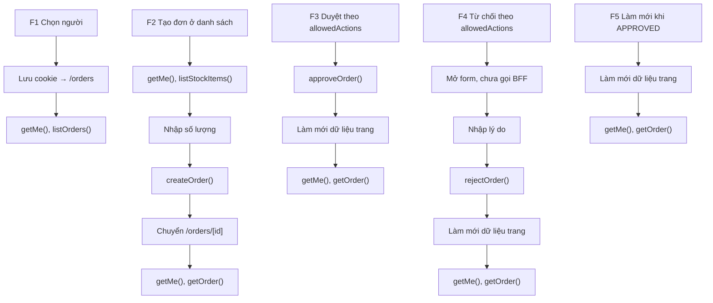

# Đặc tả frontend NEO Mini

> **Mục đích:** Đối chiếu thiết kế Figma với bốn màn web và đề xuất ánh xạ sang component. Tài liệu chỉ đặc tả giao diện; các điểm thiếu nguồn hoặc lệch hợp đồng được giữ để xác nhận.
>
> **Đối tượng đọc:** Người triển khai web, người rà thiết kế và người chấm bài.
>
> **Nguồn:** Figma trang “NEO Mini - Web”; mục 4.8, 7 của [đề](../source/neo-mini.md), mục 6.2–6.3 cho danh tính và dữ liệu; quyết định Q11, Q17, Q25, Q28, Q31–Q34, Q38, Q39.

Quy tắc code, tiền và kiểm quyền định nghĩa tại [conventions.md](../conventions.md), mục 3–5, 8 (**BẮT BUỘC**; Server Component mặc định và đặt ranh giới Client sâu nhất có thể là **NÊN**). Phiên bản chỉ xem [tech-stack.md](../tech-stack.md). Hợp đồng dữ liệu chỉ xem [api-contract.md](api-contract.md). Phần đề xuất triển khai dưới đây là **Gợi ý (ngoài đề)**, chưa phải quyết định mới.

## 1. Nguồn thiết kế

| Thuộc tính | Giá trị đã đọc |
|---|---|
| File | [Untitled](https://www.figma.com/design/VuykjXk2pbaOR9PlOGZtLv/Untitled); tên DocumentNode công cụ trả về: `Document` |
| File key | `VuykjXk2pbaOR9PlOGZtLv` |
| Ngày đọc | 26/10/2026, giờ Việt Nam |
| Trang | `NEO Mini - Web`, node `0:1` |
| Sections | `/`, `/orders`, `/orders/new`, `/orders/[id]`, `Components` |
| Phiên bản file | Công cụ không trả mã phiên bản; node id ghi ở mục 2 |
| Phương pháp | Plugin API chỉ đọc: cấu trúc toàn trang, Variables, Text Styles, component sets/variants, chuỗi và reactions; ảnh chụp 9 frame đại diện |
| Ảnh đã xem | `2:5766`, `2:5939`, `2:6532`, `2:7499`, `2:5868`, `2:6594`, `2:7718`, `2:7642`, `2:8325` |
| Prototype | 0 node có reactions. Frame bàn giao xác nhận “chưa nối tương tác prototype” |

Quy ước thực tế là `<nhóm route>/<trạng thái hoặc biến thể>/<khổ>`, không phải tên route nguyên văn. Ánh xạ `home` → `/`, `orders` → `/orders`, `orders-new` → `/orders/new`, `orders-id` → `/orders/[id]`. Giữ nguyên chữ thường và dấu gạch nối của Figma.

> **CẦN XÁC NHẬN UI-01 — phạm vi “mọi frame”:** Cách A: kiểm kê frame trực tiếp trong Section (50 màn + 1 bàn giao). Cách B: kiểm kê cả 1.135 node loại FRAME, gồm 1.084 khung bố cục lồng. Đề xuất A cho bảng màn hình dưới đây; số 51/51 chỉ chứng minh phạm vi A, chưa đáp ứng cách B. Component variants được kiểm kê riêng ở mục 4.
>
> **CẦN XÁC NHẬN UI-02 — nhãn a–i:** File hiện tại không có frame hoặc variant tên `a`–`i`. Cách A: dùng 9 trạng thái chi tiết đầu tiên theo thứ tự canvas làm nhãn đối chiếu của docs; cách B: cần một phiên bản thiết kế khác có nhãn a–i. Đề xuất A ở mục 5.4, không đổi tên Figma.

## 2. Kiểm kê frame

Bảng có **51 dòng = 51 frame trực tiếp trong Sections đã đọc**: 50 màn (25 Desktop 1440, 25 Mobile 390) và 1 bàn giao 2070. “Biến thể” tách từ phần hậu tố khi có; tên frame gốc luôn giữ nguyên. Không xem khung bố cục lồng là màn độc lập (UI-01).

| Tên frame | Node id | Route | Trạng thái | Biến thể | Khổ |
|---|---|---|---|---|---|
| `Bàn giao · Màn hình, token và giả định` | `2:19194` | — | `bàn giao` | — | Bàn giao 2070 |
| `home/default/desktop` | `2:5766` | `/` | `default` | — | Desktop 1440 |
| `home/default/mobile` | `2:5818` | `/` | `default` | — | Mobile 390 |
| `orders/normal-binh/desktop` | `2:5868` | `/orders` | `normal-binh` | binh | Desktop 1440 |
| `orders/normal-binh/mobile` | `2:5939` | `/orders` | `normal-binh` | binh | Mobile 390 |
| `orders/normal-chi/desktop` | `2:6026` | `/orders` | `normal-chi` | chi | Desktop 1440 |
| `orders/normal-chi/mobile` | `2:6093` | `/orders` | `normal-chi` | chi | Mobile 390 |
| `orders/loading/desktop` | `2:6176` | `/orders` | `loading` | — | Desktop 1440 |
| `orders/loading/mobile` | `2:6206` | `/orders` | `loading` | — | Mobile 390 |
| `orders/empty/desktop` | `2:6238` | `/orders` | `empty` | — | Desktop 1440 |
| `orders/empty/mobile` | `2:6260` | `/orders` | `empty` | — | Mobile 390 |
| `orders/error/desktop` | `2:6284` | `/orders` | `error` | — | Desktop 1440 |
| `orders/error/mobile` | `2:6309` | `/orders` | `error` | — | Mobile 390 |
| `orders-new/loading/desktop` | `2:6336` | `/orders/new` | `loading` | — | Desktop 1440 |
| `orders-new/loading/mobile` | `2:6372` | `/orders/new` | `loading` | — | Mobile 390 |
| `orders-new/empty/desktop` | `2:6410` | `/orders/new` | `empty` | — | Desktop 1440 |
| `orders-new/empty/mobile` | `2:6438` | `/orders/new` | `empty` | — | Mobile 390 |
| `orders-new/error-load/desktop` | `2:6468` | `/orders/new` | `error-load` | — | Desktop 1440 |
| `orders-new/error-load/mobile` | `2:6499` | `/orders/new` | `error-load` | — | Mobile 390 |
| `orders-new/normal/desktop` | `2:6532` | `/orders/new` | `normal` | — | Desktop 1440 |
| `orders-new/normal/mobile` | `2:6594` | `/orders/new` | `normal` | — | Mobile 390 |
| `orders-new/submitting/desktop` | `2:6664` | `/orders/new` | `submitting` | — | Desktop 1440 |
| `orders-new/submitting/mobile` | `2:6727` | `/orders/new` | `submitting` | — | Mobile 390 |
| `orders-new/error-create/desktop` | `2:6798` | `/orders/new` | `error-create` | — | Desktop 1440 |
| `orders-new/error-create/mobile` | `2:6863` | `/orders/new` | `error-create` | — | Mobile 390 |
| `orders-new/error-no-quantity/desktop` | `2:6936` | `/orders/new` | `error-no-quantity` | — | Desktop 1440 |
| `orders-new/error-no-quantity/mobile` | `2:7001` | `/orders/new` | `error-no-quantity` | — | Mobile 390 |
| `orders-new/error-invalid-quantity/desktop` | `2:7074` | `/orders/new` | `error-invalid-quantity` | — | Desktop 1440 |
| `orders-new/error-invalid-quantity/mobile` | `2:7140` | `/orders/new` | `error-invalid-quantity` | — | Mobile 390 |
| `orders-id/pending-approver/desktop` | `2:7214` | `/orders/[id]` | `pending-approver` | approver | Desktop 1440 |
| `orders-id/pending-approver/mobile` | `2:7266` | `/orders/[id]` | `pending-approver` | approver | Mobile 390 |
| `orders-id/pending-creator/desktop` | `2:7327` | `/orders/[id]` | `pending-creator` | creator | Desktop 1440 |
| `orders-id/pending-creator/mobile` | `2:7375` | `/orders/[id]` | `pending-creator` | creator | Mobile 390 |
| `orders-id/reject-invalid/desktop` | `2:7432` | `/orders/[id]` | `reject-invalid` | — | Desktop 1440 |
| `orders-id/reject-invalid/mobile` | `2:7499` | `/orders/[id]` | `reject-invalid` | — | Mobile 390 |
| `orders-id/reject-valid/desktop` | `2:7575` | `/orders/[id]` | `reject-valid` | — | Desktop 1440 |
| `orders-id/reject-valid/mobile` | `2:7642` | `/orders/[id]` | `reject-valid` | — | Mobile 390 |
| `orders-id/approved/desktop` | `2:7718` | `/orders/[id]` | `approved` | — | Desktop 1440 |
| `orders-id/approved/mobile` | `2:7772` | `/orders/[id]` | `approved` | — | Mobile 390 |
| `orders-id/reserved/desktop` | `2:7835` | `/orders/[id]` | `reserved` | — | Desktop 1440 |
| `orders-id/reserved/mobile` | `2:7885` | `/orders/[id]` | `reserved` | — | Mobile 390 |
| `orders-id/out-of-stock/desktop` | `2:7944` | `/orders/[id]` | `out-of-stock` | — | Desktop 1440 |
| `orders-id/out-of-stock/mobile` | `2:7994` | `/orders/[id]` | `out-of-stock` | — | Mobile 390 |
| `orders-id/rejected/desktop` | `2:8053` | `/orders/[id]` | `rejected` | — | Desktop 1440 |
| `orders-id/rejected/mobile` | `2:8103` | `/orders/[id]` | `rejected` | — | Mobile 390 |
| `orders-id/error-self-approval/desktop` | `2:8162` | `/orders/[id]` | `error-self-approval` | — | Desktop 1440 |
| `orders-id/error-self-approval/mobile` | `2:8210` | `/orders/[id]` | `error-self-approval` | — | Mobile 390 |
| `orders-id/loading/desktop` | `2:8267` | `/orders/[id]` | `loading` | — | Desktop 1440 |
| `orders-id/loading/mobile` | `2:8295` | `/orders/[id]` | `loading` | — | Mobile 390 |
| `orders-id/not-found/desktop` | `2:8325` | `/orders/[id]` | `not-found` | — | Desktop 1440 |
| `orders-id/not-found/mobile` | `2:8350` | `/orders/[id]` | `not-found` | — | Mobile 390 |

<a id="tokens"></a>
## 3. Design tokens và Text Styles

**Bổ sung ngoài đề (từ Figma):** collection `NEO Mini` chỉ có mode `Sáng` (`2:0`); không thấy mode tối. Có **56 Variables = 56 dòng ánh xạ**, gồm 25 màu, 20 khoảng cách, 4 bo góc, 6 cỡ chữ và 1 họ chữ. Có **8 Text Styles = 8 dòng**. Đây là nơi duy nhất trong docs ghi giá trị màu.

> **Gợi ý (ngoài đề):** Khóa Tailwind dưới đây là đề xuất; tiền tố `neo-` tránh nhầm giá trị mặc định. Màu chuyển từ RGB của Figma sang hex 8-bit để đối chiếu (làm tròn từng kênh); mọi alpha bằng 1. Biến số dùng px, không hiểu `space/4` thành thang spacing mặc định. Chỉ khai token tại theme và dùng lớp theo [conventions.md](../conventions.md), mục 8: **BẮT BUỘC** không hex hoặc `style=` rải rác.

### 3.1. Màu giao diện

| Nhóm | Tên biến Figma | Giá trị | Khóa theme Tailwind đề xuất | Nơi dùng |
|---|---|---|---|---|
| Màu | `color/background` | `#f7f8fa` | `--color-neo-background` | Nền trang |
| Màu | `color/surface` | `#ffffff` | `--color-neo-surface` | Thẻ, bảng, input |
| Màu | `color/border` | `#dce1e8` | `--color-neo-border` | Viền |
| Màu | `color/text` | `#18202c` | `--color-neo-text` | Chữ chính |
| Màu | `color/text-muted` | `#596474` | `--color-neo-text-muted` | Chữ phụ |
| Màu | `color/surface-subtle` | `#f2f4f7` | `--color-neo-surface-subtle` | Tiêu đề bảng, nhãn quyền |
| Màu | `color/primary` | `#3546a6` | `--color-neo-primary` | Nút chính |
| Màu | `color/disabled-surface` | `#e8ebf0` | `--color-neo-disabled-surface` | Nút vô hiệu hóa |
| Màu | `color/skeleton` | `#e5e9ef` | `--color-neo-skeleton` | Đang tải |
| Màu | `color/disabled-border` | `#e4e7ec` | `--color-neo-disabled-border` | Viền vô hiệu hóa |
| Màu | `color/text-disabled` | `#667085` | `--color-neo-text-disabled` | Chữ vô hiệu hóa |
| Màu | `color/danger` | `#ad2130` | `--color-neo-danger` | Từ chối, lỗi |
| Màu | `color/danger-bg` | `#fff0f2` | `--color-neo-danger-bg` | Nền lỗi |
| Màu | `color/info` | `#364570` | `--color-neo-info` | Thông báo chờ |
| Màu | `color/info-bg` | `#f0f5ff` | `--color-neo-info-bg` | Nền thông báo chờ |

### 3.2. Năm nhóm màu trạng thái đơn

Mỗi trạng thái có token chữ và nền; không biểu đạt trạng thái bằng màu đơn lẻ. Tên trạng thái nghiệp vụ chỉ định nghĩa tại [business-rules.md](business-rules.md), mục 2.

| Nhóm | Tên biến Figma | Giá trị | Khóa theme Tailwind đề xuất | Nơi dùng |
|---|---|---|---|---|
| Màu pending | `color/status-pending-bg` | `#fff5d6` | `--color-neo-status-pending-bg` | StatusBadge, nền |
| Màu pending | `color/status-pending` | `#805800` | `--color-neo-status-pending` | StatusBadge, chữ và chấm |
| Màu approved | `color/status-approved-bg` | `#eaf4fc` | `--color-neo-status-approved-bg` | StatusBadge, nền |
| Màu approved | `color/status-approved` | `#155e91` | `--color-neo-status-approved` | StatusBadge, chữ và chấm |
| Màu reserved | `color/status-reserved-bg` | `#e8f5ec` | `--color-neo-status-reserved-bg` | StatusBadge, nền |
| Màu reserved | `color/status-reserved` | `#176442` | `--color-neo-status-reserved` | StatusBadge, chữ và chấm |
| Màu out-of-stock | `color/status-out-of-stock-bg` | `#fff0e5` | `--color-neo-status-out-of-stock-bg` | StatusBadge, nền |
| Màu out-of-stock | `color/status-out-of-stock` | `#994212` | `--color-neo-status-out-of-stock` | StatusBadge, chữ và chấm |
| Màu rejected | `color/status-rejected-bg` | `#f4ecfa` | `--color-neo-status-rejected-bg` | StatusBadge, nền |
| Màu rejected | `color/status-rejected` | `#744291` | `--color-neo-status-rejected` | StatusBadge, chữ và chấm |

### 3.3. Khoảng cách, bo góc và chữ

| Nhóm | Tên biến Figma | Giá trị | Khóa theme Tailwind đề xuất | Nơi dùng |
|---|---|---|---|---|
| Họ chữ | `font/family` | Inter | `--font-neo` | Toàn giao diện |
| Khoảng cách | `space/0` | 0 px | `--spacing-neo-0` | Padding, gap theo binding Figma |
| Khoảng cách | `space/3` | 3 px | `--spacing-neo-3` | Padding, gap theo binding Figma |
| Khoảng cách | `space/4` | 4 px | `--spacing-neo-4` | Padding, gap theo binding Figma |
| Khoảng cách | `space/5` | 5 px | `--spacing-neo-5` | Padding, gap theo binding Figma |
| Khoảng cách | `space/6` | 6 px | `--spacing-neo-6` | Padding, gap theo binding Figma |
| Khoảng cách | `space/8` | 8 px | `--spacing-neo-8` | Padding, gap theo binding Figma |
| Khoảng cách | `space/10` | 10 px | `--spacing-neo-10` | Padding, gap theo binding Figma |
| Khoảng cách | `space/12` | 12 px | `--spacing-neo-12` | Padding, gap theo binding Figma |
| Khoảng cách | `space/14` | 14 px | `--spacing-neo-14` | Padding, gap theo binding Figma |
| Khoảng cách | `space/16` | 16 px | `--spacing-neo-16` | Padding, gap theo binding Figma |
| Khoảng cách | `space/18` | 18 px | `--spacing-neo-18` | Padding, gap theo binding Figma |
| Khoảng cách | `space/20` | 20 px | `--spacing-neo-20` | Padding, gap theo binding Figma |
| Khoảng cách | `space/24` | 24 px | `--spacing-neo-24` | Padding, gap theo binding Figma |
| Khoảng cách | `space/32` | 32 px | `--spacing-neo-32` | Padding, gap theo binding Figma |
| Khoảng cách | `space/40` | 40 px | `--spacing-neo-40` | Padding, gap theo binding Figma |
| Khoảng cách | `space/44` | 44 px | `--spacing-neo-44` | Padding, gap theo binding Figma |
| Khoảng cách | `space/48` | 48 px | `--spacing-neo-48` | Padding, gap theo binding Figma |
| Khoảng cách | `space/64` | 64 px | `--spacing-neo-64` | Padding, gap theo binding Figma |
| Khoảng cách | `space/120` | 120 px | `--spacing-neo-120` | Padding, gap theo binding Figma |
| Khoảng cách | `space/280` | 280 px | `--spacing-neo-280` | Padding, gap theo binding Figma |
| Bo góc | `radius/none` | 0 px | `--radius-neo-none` | Bo góc theo binding Figma |
| Bo góc | `radius/sm` | 4 px | `--radius-neo-sm` | Bo góc theo binding Figma |
| Bo góc | `radius/md` | 6 px | `--radius-neo-md` | Bo góc theo binding Figma |
| Bo góc | `radius/lg` | 8 px | `--radius-neo-lg` | Bo góc theo binding Figma |
| Cỡ chữ | `font/size-12` | 12 px | `--text-neo-12` | Text Styles bên dưới |
| Cỡ chữ | `font/size-14` | 14 px | `--text-neo-14` | Text Styles bên dưới |
| Cỡ chữ | `font/size-18` | 18 px | `--text-neo-18` | Text Styles bên dưới |
| Cỡ chữ | `font/size-20` | 20 px | `--text-neo-20` | Text Styles bên dưới |
| Cỡ chữ | `font/size-24` | 24 px | `--text-neo-24` | Text Styles bên dưới |
| Cỡ chữ | `font/size-28` | 28 px | `--text-neo-28` | Text Styles bên dưới |

| Text Style Figma | Giá trị | Lớp chữ đề xuất | Nơi dùng |
|---|---|---|---|
| `NEO/Caption` | Inter 12px, Regular, line-height 150%, letter-spacing 0% | `font-neo text-neo-12 font-normal leading-[1.5] tracking-normal` | Chú thích, mã hàng |
| `NEO/LabelSmall` | Inter 12px, Semi Bold, line-height 150%, letter-spacing 0% | `font-neo text-neo-12 font-semibold leading-[1.5] tracking-normal` | Nhãn nhỏ, trạng thái |
| `NEO/Body` | Inter 14px, Regular, line-height 150%, letter-spacing 0% | `font-neo text-neo-14 font-normal leading-[1.5] tracking-normal` | Nội dung |
| `NEO/Label` | Inter 14px, Semi Bold, line-height 150%, letter-spacing 0% | `font-neo text-neo-14 font-semibold leading-[1.5] tracking-normal` | Nút, nhãn, MoneyText |
| `NEO/Section` | Inter 18px, Semi Bold, line-height 150%, letter-spacing 0% | `font-neo text-neo-18 font-semibold leading-[1.5] tracking-normal` | Tiêu đề nhóm |
| `NEO/Brand` | Inter 20px, Semi Bold, line-height 150%, letter-spacing 0% | `font-neo text-neo-20 font-semibold leading-[1.5] tracking-normal` | Thương hiệu |
| `NEO/TitleMobile` | Inter 24px, Semi Bold, line-height 150%, letter-spacing 0% | `font-neo text-neo-24 font-semibold leading-[1.5] tracking-normal` | Tiêu đề Mobile |
| `NEO/Title` | Inter 28px, Semi Bold, line-height 150%, letter-spacing 0% | `font-neo text-neo-28 font-semibold leading-[1.5] tracking-normal` | Tiêu đề Desktop |

<a id="components"></a>
## 4. Ánh xạ component

**Bổ sung ngoài đề (từ Figma):** 13 COMPONENT_SET chứa đủ 120 COMPONENT variants; không có component độc lập ngoài các sets. Mỗi dòng dưới ánh xạ một bộ; cột variants bao phủ toàn bộ 120 component, không yêu cầu 120 file React. Tất cả có code dùng lại; frame bàn giao “không code” vì chỉ là tài liệu trên canvas.

> **Gợi ý (ngoài đề):** Tên React giữ PascalCase như Figma; đường dẫn, props và ranh giới Server/Client là phương án triển khai. Các đường dẫn là file dự kiến, chưa tồn tại. “Server” nghĩa là không đặt chỉ thị; component thuần hiển thị vẫn có thể được nhập vào cây Client. Chỉ component có tương tác mới đặt `'use client'` theo [conventions.md](../conventions.md), mục 8.

| Component Figma (node set) | React component | File dưới web/src/ | Server / Client | Props chính đề xuất | Variants nguyên tên Figma | Trạng thái hỗ trợ |
|---|---|---|---|---|---|---|
| AppHeader (`2:19189`) | AppHeader | `components/AppHeader.tsx` | Server; liên kết điều hướng thường | me | `Variant=V01`–`Variant=V06` | Mobile/Desktop; danh tính mẫu; nhãn quyền là chữ |
| UserCard (`2:19182`) | UserCard | `components/UserCard.tsx` | Server; nút chọn Client nhỏ | user, children | `Variant=V01`–`Variant=V08` | 4 người dùng, hai bố cục |
| StatusBadge (`2:19178`) | StatusBadge | `components/StatusBadge.tsx` | Server | status | `Variant=Pending`, `Variant=Approved`, `Variant=Reserved`, `Variant=OutOfStock`, `Variant=Rejected` | 5 nhãn tại mục 7 |
| MoneyText (`2:19177`) | MoneyText | `components/MoneyText.tsx` | Server | money, alignment | `Variant=V01`–`Variant=V08` | Căn lề/độ rộng khác nhau; một kiểu chữ, qua formatMoney |
| OrdersTable (`2:19183`) | OrdersTable | `components/OrdersTable.tsx` | Server; dùng liên kết tới đơn | orders | `Variant=V01`, `Variant=V02` | Thẻ Mobile / bảng Desktop; 5 trạng thái |
| StockTable (`2:19184`) | StockTable | `components/StockTable.tsx` | Server cho bảng; form/ô nhập Client nhỏ | items, children | `Variant=V01`–`Variant=V08` | Thẻ/bảng, bình thường, toàn số 0, sai số lượng, đang gửi |
| QuantityInput (`2:19179`) | QuantityInput | `components/QuantityInput.tsx` | Client | sku, value, disabled, error, onChange | `Variant=V01`–`Variant=V03` | Nhập, lỗi, vô hiệu hóa; giá trị là thuộc tính nội dung |
| OrderLinesTable (`2:19185`) | OrderLinesTable | `components/OrderLinesTable.tsx` | Server | lines, totalAmount | `Variant=V01`, `Variant=V02` | Thẻ / bảng; tiền từ response; tên hàng thiếu nguồn (UI-05) |
| ActionBar (`2:19188`) | ActionBar | `components/ActionBar.tsx` | Client khi có mutation/làm mới | allowedActions, status, pending, callbacks | `Variant=V01`–`Variant=V14` | Duyệt/từ chối, tạo/đang tạo, xác nhận/hủy, thử lại |
| RejectForm (`2:19186`) | RejectForm | `components/RejectForm.tsx` | Client | reason, error, pending, onSubmit, onCancel | `Variant=V01`–`Variant=V04` | Hợp lệ/không hợp lệ × Mobile/Desktop |
| StateView (`2:19187`) | StateView | `components/StateView.tsx` | Server; nút thử lại Client nhỏ | kind, title, message, children | `Variant=V01`–`Variant=V14` | Loading, empty, error, not-found theo màn |
| Button (`2:19180`) | Button | `components/Button.tsx` | Client khi có xử lý click; liên kết thường không cần | children, disabled, pending, onClick | `Variant=V01`–`Variant=V28` | Chọn người, điều hướng, mutation, thử lại, disabled |
| Alert (`2:19181`) | Alert | `components/Alert.tsx` | Server | message, tone, children | `Variant=V01`–`Variant=V18` | Thông báo kho, tự duyệt, lỗi nhập/tạo |

> **Gợi ý (ngoài đề):** Mỗi component phải giữ trong giới hạn ở [conventions.md](../conventions.md), mục 3 (**BẮT BUỘC**, React ≤ 200 dòng). Figma không chứng minh số dòng code. OrdersTable, StockTable, OrderLinesTable và RejectForm có nhiều nhánh; đề xuất tách `OrderRow`/`OrderCard`, `StockRow`/`StockCard`, `OrderLineRow`/`OrderLineCard`, `RejectReasonField` và `RejectFormActions` vào `components/` khi cần. Các tên tách này không phải component có sẵn trong Figma. AppHeader nhận dữ liệu thay vì tạo nhánh theo tên người; variants chỉ minh họa.

<a id="routes"></a>
## 5. Đặc tả từng route

<a id="lib-data"></a>
### Dữ liệu chung và hàm lib/data

Tên hàm do Q38 chốt (**bổ sung ngoài đề**, trừ hai ví dụ `listOrders()`, `approveOrder()`). Bảng tên chuẩn ở [web.md](web.md), mục 4; endpoint tương ứng ở [api-contract.md](api-contract.md#5-rest-của-bff). Các mục dưới chỉ dẫn hàm sử dụng, không định nghĩa lại REST. Danh tính tuân theo [api-contract.md](api-contract.md#6-danh-tính-đi-qua-các-tầng); `getMe()` cung cấp props cho AppHeader ở ba màn dữ liệu (Q33, **bổ sung ngoài đề**).

### 5.1. Route /

- Trang (Server)
  - AppHeader (chỉ thương hiệu)
  - Tiêu đề, mô tả
  - Danh sách UserCard
    - Nhãn công ty/quyền
    - Button chọn người (Client)
  - Chú thích cách ly công ty

Dữ liệu: bốn người cố định; không gọi lib/data ở màn này (Q34, **bổ sung ngoài đề**). Thao tác chọn lưu danh tính và chuyển trang theo [web.md](web.md), mục 2.

| Trạng thái | Frame Figma | Xử lý |
|---|---|---|
| Bình thường | `home/default/desktop`, `home/default/mobile` | 4 UserCard |
| Đang tải / rỗng / lỗi | Không có | Không áp dụng theo Q34 (**bổ sung ngoài đề**) |

### 5.2. Route /orders

- Trang (Server): getMe(), listOrders()
  - AppHeader
  - Tiêu đề “Đơn hàng”, liên kết “Tạo đơn”
  - OrdersTable
    - StatusBadge, MoneyText, liên kết tới chi tiết
  - Hoặc StateView
    - Button thử lại (Client)

Dữ liệu: `getMe()`, `listOrders()`; đối chiếu endpoint bằng [hàm lib/data](#lib-data). Quy tắc nút tạo đơn giữ [web.md](web.md), mục 5; tên `normal-binh`/`normal-chi` là ví dụ thiết kế, không là điều kiện trong code.

| Trạng thái | Frame Figma (cả desktop và mobile, xem node ở mục 2) | Hiển thị |
|---|---|---|
| Bình thường, có quyền tạo | `orders/normal-binh/desktop`, `orders/normal-binh/mobile` | Danh sách, nút Tạo đơn |
| Bình thường, không có quyền tạo | `orders/normal-chi/desktop`, `orders/normal-chi/mobile` | Danh sách, không có nút Tạo đơn |
| Đang tải | `orders/loading/desktop`, `orders/loading/mobile` | Skeleton + chỉ báo |
| Rỗng | `orders/empty/desktop`, `orders/empty/mobile` | Chưa có đơn nào |
| Lỗi | `orders/error/desktop`, `orders/error/mobile` | StateView, message BFF, thử lại |

### 5.3. Route /orders/new

- Trang (Server): getMe(), listStockItems()
  - AppHeader; liên kết về danh sách; tiêu đề
  - Form tạo đơn (Client, tên tách đề xuất: OrderCreateForm)
    - Alert khi lỗi
    - StockTable
      - MoneyText; khả dụng từ API; QuantityInput
    - ActionBar: chú thích tổng tiền; nút tạo
  - Hoặc StateView khi chưa có dữ liệu

Dữ liệu: `getMe()`, `listStockItems()`, mutation `createOrder()`; endpoint xem [hàm lib/data](#lib-data). Thành tiền và khả dụng áp dụng [conventions.md](../conventions.md), mục 4, 8; không có tổng tiền xem trước trong Figma.

| Trạng thái | Frame Figma (tiền tố orders-new/, có cả /desktop và /mobile) | Hiển thị |
|---|---|---|
| Đang tải | `orders-new/loading/desktop`, `orders-new/loading/mobile` | Chỉ báo + chú thích tổng tiền |
| Rỗng | `orders-new/empty/desktop`, `orders-new/empty/mobile` | Chưa có mặt hàng |
| Lỗi tải | `orders-new/error-load/desktop`, `orders-new/error-load/mobile` | Message + thử lại |
| Bình thường | `orders-new/normal/desktop`, `orders-new/normal/mobile` | Mặt hàng, đơn giá, khả dụng, nhập số lượng |
| Đang gửi | `orders-new/submitting/desktop`, `orders-new/submitting/mobile` | “Đang tạo đơn…”; trạng thái vô hiệu hóa |
| Lỗi tạo | `orders-new/error-create/desktop`, `orders-new/error-create/mobile` | Alert; giữ form |
| Chưa chọn số lượng | `orders-new/error-no-quantity/desktop`, `orders-new/error-no-quantity/mobile` | Thông báo ít nhất một mặt hàng |
| Số lượng sai | `orders-new/error-invalid-quantity/desktop`, `orders-new/error-invalid-quantity/mobile` | Alert, ô lỗi |

> **Gợi ý (ngoài đề):** Ô 0 nghĩa là chưa chọn, khi gửi chỉ lấy các dòng dương; vẫn để service kiểm đầu vào theo [api-contract.md](api-contract.md), mục 2 (Q28, **bổ sung ngoài đề**). Sau tạo có thể chuyển đến chi tiết như gợi ý đã có ở [web.md](web.md), mục 2. Không tự thêm kiểm tra “số lượng ≤ khả dụng” ở web.

### 5.4. Route /orders/[id]

- Trang (Server): getMe(), getOrder()
  - AppHeader; liên kết về danh sách
  - Mã đơn, StatusBadge, người lập
  - Alert kết quả kho/lỗi
  - OrderLinesTable
    - MoneyText cho đơn giá, thành tiền, tổng trả về
  - ActionBar (Client)
    - Button Duyệt / Từ chối hoặc Làm mới
    - RejectForm (Client) khi người dùng mở
  - Lý do từ chối đã lưu; hoặc StateView

Dữ liệu: `getMe()`, `getOrder()`, `approveOrder()`, `rejectOrder()`; endpoint xem [hàm lib/data](#lib-data). Quy tắc nút định nghĩa tại [web.md](web.md), mục 5. Nút Duyệt/Từ chối chỉ đọc `allowedActions`; thông tin “người xem” dưới đây là bối cảnh frame, không là phép kiểm ở web. Làm mới là ngoại lệ theo trạng thái đã có trong đề.

| Nhãn đối chiếu docs (UI-02) | Trạng thái đơn × người xem minh họa | allowedActions trong hợp đồng | Khu thao tác | Frame Desktop / Mobile |
|---|---|---|---|---|
| a (không phải tên Figma) | PENDING_APPROVAL × người được duyệt, minh họa binh | Có APPROVE, REJECT | Duyệt, Từ chối | [pending-approver D](https://www.figma.com/design/VuykjXk2pbaOR9PlOGZtLv/Untitled?node-id=2-7214) / [M](https://www.figma.com/design/VuykjXk2pbaOR9PlOGZtLv/Untitled?node-id=2-7266) |
| b (không phải tên Figma) | PENDING_APPROVAL × người lập, minh họa an | [] | Không nút duyệt/từ chối; có chú thích | [pending-creator D](https://www.figma.com/design/VuykjXk2pbaOR9PlOGZtLv/Untitled?node-id=2-7327) / [M](https://www.figma.com/design/VuykjXk2pbaOR9PlOGZtLv/Untitled?node-id=2-7375) |
| c (không phải tên Figma) | PENDING_APPROVAL × người được từ chối, lý do sai | Có APPROVE, REJECT | Form mở, xác nhận disabled | [reject-invalid D](https://www.figma.com/design/VuykjXk2pbaOR9PlOGZtLv/Untitled?node-id=2-7432) / [M](https://www.figma.com/design/VuykjXk2pbaOR9PlOGZtLv/Untitled?node-id=2-7499) |
| d (không phải tên Figma) | PENDING_APPROVAL × người được từ chối, lý do hợp lệ | Có APPROVE, REJECT | Form mở, xác nhận bật | [reject-valid D](https://www.figma.com/design/VuykjXk2pbaOR9PlOGZtLv/Untitled?node-id=2-7575) / [M](https://www.figma.com/design/VuykjXk2pbaOR9PlOGZtLv/Untitled?node-id=2-7642) |
| e (không phải tên Figma) | APPROVED × người xem đơn | [] | Chỉ Làm mới | [approved D](https://www.figma.com/design/VuykjXk2pbaOR9PlOGZtLv/Untitled?node-id=2-7718) / [M](https://www.figma.com/design/VuykjXk2pbaOR9PlOGZtLv/Untitled?node-id=2-7772) |
| f (không phải tên Figma) | RESERVED × người xem đơn | [] | Không thao tác | [reserved D](https://www.figma.com/design/VuykjXk2pbaOR9PlOGZtLv/Untitled?node-id=2-7835) / [M](https://www.figma.com/design/VuykjXk2pbaOR9PlOGZtLv/Untitled?node-id=2-7885) |
| g (không phải tên Figma) | OUT_OF_STOCK × người xem đơn | [] | Không thao tác | [out-of-stock D](https://www.figma.com/design/VuykjXk2pbaOR9PlOGZtLv/Untitled?node-id=2-7944) / [M](https://www.figma.com/design/VuykjXk2pbaOR9PlOGZtLv/Untitled?node-id=2-7994) |
| h (không phải tên Figma) | REJECTED × người xem đơn | [] | Không thao tác; lý do đã lưu | [rejected D](https://www.figma.com/design/VuykjXk2pbaOR9PlOGZtLv/Untitled?node-id=2-8053) / [M](https://www.figma.com/design/VuykjXk2pbaOR9PlOGZtLv/Untitled?node-id=2-8103) |
| i (không phải tên Figma) | PENDING_APPROVAL × an, minh họa lỗi tự duyệt | [] | Alert lỗi, không thêm nút | [error-self-approval D](https://www.figma.com/design/VuykjXk2pbaOR9PlOGZtLv/Untitled?node-id=2-8162) / [M](https://www.figma.com/design/VuykjXk2pbaOR9PlOGZtLv/Untitled?node-id=2-8210) |

| Trạng thái trang | Frame Figma | Ghi nhận |
|---|---|---|
| Bình thường và biến thể | 18 frame a–i đối chiếu ở trên, tên đầy đủ tại mục 2 | Không có biến thể người xem thiếu quyền nhưng không phải người lập |
| Đang tải | `orders-id/loading/desktop`, `orders-id/loading/mobile` | Đang tải đơn hàng… |
| Rỗng / không tìm thấy | `orders-id/not-found/desktop`, `orders-id/not-found/mobile` | Có thể xem là rỗng theo NOT_FOUND; cần xác nhận UI-04 |
| Lỗi BFF tổng quát | Không có frame riêng | SELF_APPROVAL có frame i, không thay được mọi lỗi; UI-04 |

> **CẦN XÁC NHẬN UI-05 — tên hàng trong chi tiết:** Figma có tên hàng nhưng Q25 chỉ trả `sku` trong dòng đơn. Cách A: chi tiết chỉ hiện mã theo hợp đồng; cách B: cần nguồn tên hàng (gọi thêm dữ liệu kho hoặc đổi hợp đồng). Đề xuất A trước khi có quyết định; không tự thêm field hay lời gọi.
>
> **CẦN XÁC NHẬN UI-06 — lỗi tự duyệt:** Frame i dùng `an`, nhưng Q31 kiểm thiếu quyền trước nên yêu cầu duyệt của an không tạo SELF_APPROVAL. Cách A: dùng binh tự duyệt để minh họa đúng lỗi; cách B: giữ an như mock thông báo tĩnh, không coi là kịch bản API. Đề xuất A khi người phụ trách cập nhật Figma; docs không sửa thiết kế.

<a id="flows"></a>
## 6. Luồng prototype và gọi dữ liệu

> **CẦN XÁC NHẬN UI-03:** Không có 5 luồng click đã nối để đọc. Cách A: nối 5 luồng dự kiến theo màn tĩnh và đề; cách B: cung cấp phiên bản khác có prototype. Đề xuất A. Bảng và sơ đồ dưới là **Gợi ý (ngoài đề)** cho luồng dự kiến, không mô tả prototype đang hoạt động.

| Luồng dự kiến | Click và chuỗi lib/data | Frame đích / kết quả |
|---|---|---|
| F1 Chọn người | Chọn người → lưu cookie theo hợp đồng → chuyển /orders → getMe(), listOrders() | home/default → orders/normal-binh hoặc normal-chi; dữ liệu người khác dùng cùng bố cục |
| F2 Tạo đơn | Tạo đơn ở danh sách → getMe(), listStockItems() → nhập → createOrder() → chuyển /orders/[id] → getMe(), getOrder() | orders-new/normal → submitting → orders-id/pending-creator; lỗi ở error-create hoặc lỗi nhập |
| F3 Duyệt | Duyệt (theo allowedActions) → approveOrder() → làm mới dữ liệu trang → getMe(), getOrder() | pending-approver → approved, hoặc reserved/out-of-stock nếu kho đã trả lời |
| F4 Từ chối | Từ chối → mở form, chưa gọi BFF → nhập lý do → rejectOrder() → làm mới dữ liệu trang → getMe(), getOrder() | reject-invalid / reject-valid → rejected khi thành công; Hủy chỉ đóng form |
| F5 Làm mới | Chỉ khi APPROVED: Làm mới → làm mới dữ liệu trang → getMe(), getOrder() | approved → approved / reserved / out-of-stock theo response |

> **Gợi ý (ngoài đề):** “Làm mới dữ liệu trang” là ActionBar yêu cầu `router.refresh()`; Server Component chạy lại các hàm ở mục 5, với lời gọi đọc đơn không dùng dữ liệu cache cũ. Hàm `getOrder()` trong lib/data gọi lại `GetOrder` qua BFF theo [api-contract.md](api-contract.md), mục 5. Không tự chuyển sang RESERVED, không tính tiền/tồn, không thêm polling hay bộ đếm thời gian. Sau F3/F4 thành công cũng dùng cách này; lỗi mutation giữ trang và hiện nguyên message BFF. Thử lại khi lỗi tải chạy lại hàm đọc của đúng route.

Sơ đồ chỉ có 5 chuỗi F1–F5, khớp từng dòng bảng; không thể kiểm thử click trên Figma hiện tại.



## 7. Chuỗi giao diện tiếng Việt

Bảng chỉ để đối chiếu, không tạo file i18n. Chữ viết thẳng trong code theo [conventions.md](../conventions.md), mục 8 (**BẮT BUỘC**). Các khóa dưới là **Gợi ý (ngoài đề)** cho việc rà soát. Chuỗi lỗi từ BFF phải dùng nguyên `message`; mẫu Figma không thay thế response (Q32, **bổ sung ngoài đề**). Tên hàng Figma chỉ là mẫu lệch Q39 (UI-07), không là dữ liệu seed mới.

| Khóa đối chiếu | Nội dung | Nơi dùng / nguồn |
|---|---|---|
| status.pending | Chờ duyệt | StatusBadge; đề mục 2 |
| status.approved | Đã duyệt | StatusBadge; đề mục 2 (Figma dùng nhãn ngắn) |
| status.reserved | Đã giữ hàng | StatusBadge; đề mục 2 |
| status.outOfStock | Thiếu hàng | StatusBadge; đề mục 2 |
| status.rejected | Đã từ chối | StatusBadge; từ Figma (đề: Bị từ chối) |
| app.name | NEO Mini | AppHeader; tên bài |
| home.title | Chọn người dùng mẫu | home/default; từ Figma |
| home.description | Chọn một tài khoản để tạo đơn, duyệt đơn và theo dõi giữ hàng theo quyền được cấp. Không cần đăng nhập. | home/default; từ Figma |
| home.note | Dữ liệu và quyền hạn được phân tách theo công ty. | home/default; từ Figma |
| user.companyA / user.companyB | Công ty A / Công ty B | UserCard, AppHeader; từ Figma |
| user.choose | Chọn an / Chọn binh / Chọn chi / Chọn dung | UserCard; từ Figma |
| user.change | Đổi người dùng | AppHeader; từ Figma |
| capability.create / capability.approve | Tạo đơn / Duyệt đơn | Nhãn quyền; từ Figma, không phải nút duyệt đơn cụ thể |
| orders.title | Đơn hàng | /orders, nút về danh sách; từ Figma |
| orders.back | ← Đơn hàng | new, id; từ Figma |
| orders.code / orders.creator | Mã đơn / Người lập | OrdersTable; từ Figma |
| orders.total / orders.status | Tổng tiền / Trạng thái | Bảng và chi tiết; từ Figma |
| action.create / action.approve / action.reject | Tạo đơn / Duyệt / Từ chối | Nút; đề mục 7 |
| action.refresh | Làm mới | approved; đề mục 7 |
| action.retry | Thử lại | StateView; từ Figma |
| action.confirmReject / action.cancel | Xác nhận từ chối / Hủy | RejectForm; từ Figma; Hủy là đóng form, không phải EX-01 |
| new.description | Nhập số lượng mặt hàng cần đặt. | orders-new; từ Figma |
| stock.name / stock.price / stock.available / stock.quantity | Tên hàng / Đơn giá / Khả dụng / Số lượng | StockTable, thẻ; từ Figma |
| stock.low | Sắp hết | StockTable; từ Figma, UI-08 |
| new.totalHint | Tổng tiền sẽ hiển thị sau khi tạo đơn | ActionBar; từ Figma, diễn đạt đề mục 7 |
| new.submitting | Đang tạo đơn… | submitting; từ Figma |
| state.loading | Đang tải dữ liệu… | loading danh sách, kho; từ Figma |
| state.loadingOrder | Đang tải đơn hàng… | orders-id/loading; từ Figma |
| state.emptyOrders | Chưa có đơn nào | orders/empty; từ Figma |
| state.emptyOrdersHint | Các đơn hàng của công ty sẽ xuất hiện tại đây. | orders/empty; từ Figma |
| state.emptyStock | Chưa có mặt hàng | orders-new/empty; từ Figma |
| state.emptyStockHint | Danh sách mặt hàng của công ty hiện đang trống. | orders-new/empty; từ Figma |
| error.ordersTitle | Không thể tải danh sách đơn | orders/error; từ Figma |
| error.orders | Không thể tải danh sách đơn. Vui lòng thử lại. | orders/error; mẫu từ Figma, runtime dùng message |
| error.stockTitle | Không thể tải danh sách mặt hàng | orders-new/error-load; từ Figma |
| error.stock | Không thể tải danh sách mặt hàng. Vui lòng thử lại. | error-load; mẫu từ Figma, runtime dùng message |
| error.create | Không thể tạo đơn. Vui lòng thử lại. | error-create; mẫu từ Figma, runtime dùng message |
| error.noQuantity | Nhập số lượng cho ít nhất một mặt hàng. | error-no-quantity; từ Figma |
| error.quantity | Số lượng phải là số nguyên lớn hơn hoặc bằng 0. | error-invalid-quantity; từ Figma |
| error.quantityField | Giá trị không hợp lệ | error-invalid-quantity/desktop; từ Figma |
| detail.creator | Người lập: an | Chi tiết; mẫu từ Figma, phần tên lấy response |
| detail.item / detail.lineAmount | Mã hàng / Tên hàng / Thành tiền | OrderLinesTable; từ Figma; tên hàng vướng UI-05 |
| detail.waiting | Đang chờ kho phản hồi | approved; từ Figma |
| detail.held | Kho đã giữ hàng cho đơn này. | reserved; từ Figma |
| detail.short | Kho không thể giữ đủ hàng cho đơn này. | out-of-stock; từ Figma |
| reject.label | Lý do từ chối | RejectForm, rejected; từ Figma |
| reject.hint | Nhập từ 10 đến 500 ký tự. | RejectForm; từ Figma, ràng buộc ở business-rules mục 9 |
| reject.invalid | Lý do phải có từ 10 đến 500 ký tự. | reject-invalid; từ Figma |
| reject.counter | 7 / 500 hoặc 26 / 500 | RejectForm; từ Figma; số động theo Q11/Q17 |
| reject.exampleInvalid / reject.exampleValid | Sai giá / Số lượng đặt chưa phù hợp. | Giá trị nhập mẫu từ Figma, không phải placeholder |
| reject.placeholder | Không thấy placeholder riêng | Figma chỉ thể hiện ô đã nhập; không tự đặt chuỗi |
| error.selfApproval | Bạn không thể tự duyệt đơn do mình lập | error-self-approval; đề mục 6.3, message SELF_APPROVAL |
| detail.selfApprovalHint | Bạn không thể tự duyệt đơn của mình | pending-creator; từ Figma, khác message lỗi API |
| error.notFoundTitle | Không tìm thấy đơn hàng | orders-id/not-found; từ Figma |
| error.notFound | Đơn hàng không tồn tại hoặc bạn không có quyền truy cập. | not-found; mẫu từ Figma, runtime dùng message |

<a id="responsive"></a>
## 8. Responsive

**Bổ sung ngoài đề (từ Figma):** Hai khổ Desktop 1440 và Mobile 390; chiều cao thay đổi theo nội dung, không dùng 900/844 làm chiều cao cố định bắt buộc.

| Thành phần | Desktop 1440 | Mobile 390 | Bằng chứng |
|---|---|---|---|
| UserCard | Lưới 2 cột | 1 cột | home/default D/M |
| AppHeader | Danh tính, nhãn quyền, đổi người cùng hàng | Thương hiệu/đổi người ở hàng đầu; danh tính/quyền xuống hàng | orders/normal-binh D/M |
| OrdersTable | Bảng | Thẻ từng đơn, nhãn giá trị rõ ràng | orders/normal-binh D/M |
| StockTable | Bảng nhập số lượng | Thẻ từng hàng, QuantityInput bên phải | orders-new/normal D/M |
| OrderLinesTable | Bảng có hàng tổng | Thẻ dòng + thẻ tổng | orders-id/pending-approver D/M |
| ActionBar / RejectForm | Nút theo hàng, form rộng vùng nội dung | Nút mở rộng trong vùng nội dung, form xuống dưới | orders-id/reject-valid D/M |

> **Gợi ý (ngoài đề):** Điểm gãy đề xuất 768px: dưới điểm này dùng thẻ/1 cột; từ điểm này dùng bảng/lưới 2 cột. Figma chỉ chứng minh hai khổ 390 và 1440, chưa chốt hành vi trung gian; không xem 768px là yêu cầu của đề hoặc token Figma.

## 9. Khả năng truy cập quan sát được

| Quan sát | Bằng chứng | Giới hạn kết luận |
|---|---|---|
| Badge có chữ và chấm, không chỉ có màu | orders/normal-binh D/M; 5 StatusBadge variants | Có nhãn 5 trạng thái |
| Nút có nhãn chữ; Button cao 44px, QuantityInput 104 × 44px ở component gốc | Button set 2:19180; QuantityInput set 2:19179; orders-new/normal | Đo được vùng hình học; chưa kiểm hit target runtime |
| Chữ chính và chữ phụ phân cấp trên nền trang/thẻ; nút disabled có màu riêng | home/default/desktop; orders-id/reject-invalid/mobile | Chưa kết luận đạt chuẩn tương phản; không có kết quả đo trong file |
| Ô lý do có nhãn, hướng dẫn, lỗi và bộ đếm | orders-id/reject-invalid/mobile, reject-valid/mobile | Không suy ra liên kết label/input, aria hay cách đọc màn hình |
| Ô số lượng có nhãn; lỗi dùng chữ | orders-new/error-invalid-quantity D/M | Không suy ra DOM, thứ tự tab hoặc xử lý bàn phím |
| Không thấy thiết kế focus hay tương tác bàn phím | 0 reactions toàn trang; Button set | Không có bằng chứng để xác nhận hỗ trợ runtime |

<a id="structure"></a>
## 10. Cấu trúc web/src gợi ý

Các nơi đã có trong đề: `web/src/lib/data/` cho lời gọi BFF; `formatMoney()` là hàm chung theo [conventions.md](../conventions.md), mục 4. Đề không chốt file của hàm formatMoney.

> **Gợi ý (ngoài đề):** Cấu trúc sau là dự kiến; không tạo các file này trong phase docs. Theme dùng token tại mục 3, không khai lại giá trị ở đây.

```text
web/src/
├── app/
│   ├── layout.tsx
│   ├── page.tsx
│   └── orders/
│       ├── page.tsx
│       ├── new/page.tsx
│       └── [id]/page.tsx
├── components/           các component mục 4; tách phần tương tác
├── lib/
│   ├── data/             các hàm Q38, xem mục 5
│   └── formatMoney.ts    vị trí đề xuất của hàm chung
└── theme/
    └── tokens.css        khóa theme đề xuất ở mục 3
```

<a id="compliance"></a>
## 11. KIỂM TUÂN THỦ — Figma so với đặc tả

“Đạt” chỉ xác nhận bằng chứng thiết kế; không chứng minh code đã tuân thủ. D/M nghĩa là hai frame khổ Desktop/Mobile có tên đầy đủ và id tại mục 2.

| Câu hỏi kiểm | Kết quả | Frame bằng chứng / nhận xét |
|---|---|---|
| /orders/new có hiển thị tổng tiền do người dùng nhập tính ra không (phải không)? | Đạt | orders-new/normal D/M, submitting D/M: chỉ có chú thích, không có tổng |
| Nút Duyệt/Từ chối có ngầm phụ thuộc tên người hay vai trò không (phải chỉ allowedActions)? | Không thấy rõ | pending-approver, pending-creator D/M; bàn giao 2:19194 nói theo allowedActions nhưng không có logic chạy; UI-06 là lệch kịch bản lỗi |
| Có hiển thị khả dụng/tổng tiền gợi ý client tự tính không? | Đạt | orders-new/normal, orders-id/pending-approver D/M; bàn giao nói dữ liệu từ máy chủ, không cộng tại màn tạo |
| Tiền có cùng một kiểu 1.250.000 ₫ mọi chỗ không? | Đạt | orders/normal-binh, orders-new/normal, orders-id/pending-approver D/M; toàn bộ text tiền dùng dấu chấm và ₫ |
| Đủ đang tải, rỗng, lỗi ở mọi màn áp dụng không? | Lệch | /orders và /orders/new đủ; orders-id/loading, not-found, error-self-approval D/M chưa có lỗi tải/mutation tổng quát; / miễn theo Q34; UI-04 |
| Hoàn toàn tiếng Việt, trừ định danh như DH-000001? | Đạt | home/default, orders/normal-binh, orders-new/normal, orders-id/rejected D/M; tên người, SKU, USB-C, NEO Mini là định danh, không phải nhãn tiếng Anh |
| Màu và khoảng cách đều là biến, không hex rời? | Đạt | Quét paints và padding/gap toàn trang, không thấy màu solid hay khoảng cách khác 0 chưa bind; frame 2:6532, 2:7499 minh họa. Không kiểm chứng CSS; bo góc khung biên tập không thuộc kết luận này |
| Nút Làm mới đúng và chỉ khi APPROVED? | Đạt | Chỉ orders-id/approved D/M có chuỗi Làm mới trong 50 màn |
| Ô lý do đúng 10–500 ký tự Unicode theo Q11? | Không thấy rõ | reject-invalid D/M: “Sai giá” = 7 rune; reject-valid D/M: mẫu = 26 rune. Nhãn đúng; chưa có code để xác nhận rune nguyên trạng Q17, không chứng minh bằng byte/UTF-16 |
| Có tính năng ngoài đặc tả (đăng nhập thật, tìm kiếm, lọc, phân trang, biểu đồ…)? | Lệch | AppHeader trong orders/normal-binh có Đổi người dùng; orders-new/normal có Sắp hết. Không thấy đăng nhập thật/tìm kiếm/lọc/phân trang/biểu đồ; UI-08 |
| Dữ liệu mẫu có khớp Q39 không? | Lệch | orders-new/normal D/M và bàn giao 2:19194 dùng mã A-001…B-002; UI-07 |
| Chi tiết có đủ nguồn dữ liệu API cho các trường hiển thị không? | Lệch | orders-id/pending-approver D/M có tên hàng; Q25 thiếu field tên; UI-05 |
| Kịch bản SELF_APPROVAL có đúng thứ tự kiểm Q31 không? | Lệch | orders-id/error-self-approval D/M dùng an; UI-06 |

> **CẦN XÁC NHẬN UI-04 — trạng thái thiếu:** Cách A: coi not-found là trạng thái rỗng, bổ sung thiết kế lỗi BFF tổng quát; cách B: yêu cầu thêm cả frame rỗng độc lập lẫn lỗi tổng quát. Đề xuất A cho trang chi tiết một đơn. Không dùng message mock thay message BFF; không tự sửa Figma.
>
> **CẦN XÁC NHẬN UI-07 — dữ liệu mẫu:** Cách A: thay mẫu trong Figma theo Q39; cách B: giữ Figma làm minh họa bố cục khác seed. Đề xuất A để demo nhất quán; Q39 vẫn là dữ liệu chuẩn ở [business-rules.md](business-rules.md), mục 4. Không chép bảng dữ liệu Figma thành seed mới.
>
> **CẦN XÁC NHẬN UI-08 — phần giao diện thêm:** Cách A: cho phép “Đổi người dùng” quay lại màn / và chỉ dùng “Sắp hết” như mẫu thiết kế; cách B: bỏ cả hai khỏi giao diện thực thi. Đề xuất giữ liên kết đổi người, chưa triển khai nhãn Sắp hết đến khi xác nhận tiêu chí (Figma chỉ minh họa khả dụng 1, không cho quy tắc ngưỡng). Đây là **Gợi ý (ngoài đề)**; không thêm endpoint.

## 12. Bổ sung ngoài đề (từ Figma)

| Nội dung bổ sung ngoài đề | Nguồn / giới hạn |
|---|---|
| Khổ Mobile 390, Desktop 1440; bảng chuyển thẻ | 50 frame, mục 2 và 8 |
| Palette cụ thể, font Inter, cỡ chữ, spacing, radius, mode Sáng | 56 Variables, 8 Text Styles; giá trị chỉ ở mục 3; không thấy dark mode |
| Tên 13 component, 120 variants, tổ chức bố cục | Components, mục 4; tên file React chỉ là gợi ý |
| Tên/mã hàng, đơn giá, khả dụng của mẫu Figma khác Q39 | Frame bàn giao và StockTable; UI-07; không thay dữ liệu chuẩn |
| 5 đơn minh họa và các thời điểm thay thế của DH-000001 | orders/normal-binh và 9 biến thể chi tiết; không yêu cầu seed đơn (Q16) |
| Liên kết Đổi người dùng, nhãn Sắp hết | UI-08; chưa thành yêu cầu nghiệp vụ |
| Chuỗi hướng dẫn, lỗi mock, chú thích chờ kho, xác nhận/hủy form, bộ đếm | Mục 7; lỗi thực tế vẫn lấy message BFF |
| Biến thể reject-valid, submitting, lỗi số lượng và bố cục thẻ | Các frame tương ứng tại mục 2; không bổ sung trạng thái đơn |
| Khung bàn giao 2070, mô tả giả định, danh mục token | 2:19194; không code, không phải route |

Các **Gợi ý (ngoài đề)** của docs: khóa theme/lớp chữ (mục 3); file, props, ranh giới component và cách tách (mục 4–5); cách gửi dòng đã chọn, điều hướng sau tạo (mục 5.3); 5 luồng dự kiến và refresh (mục 6); khóa đối chiếu chuỗi (mục 7); điểm gãy (mục 8); cây thư mục (mục 10). Chưa có quyết định mới thay Q1–Q39.

Đối chiếu docs: không phát hiện mâu thuẫn nghiệp vụ mới trong web.md với đề sau áp dụng Q34. Figma lệch dữ liệu Q39, nguồn tên hàng Q25 và kịch bản lỗi Q31 như UI-05–UI-07. Không thay nội dung nghiệp vụ web.md, API hay đề. Phase này không tạo code ứng dụng, không sửa Figma và không bắt đầu phase sau.

