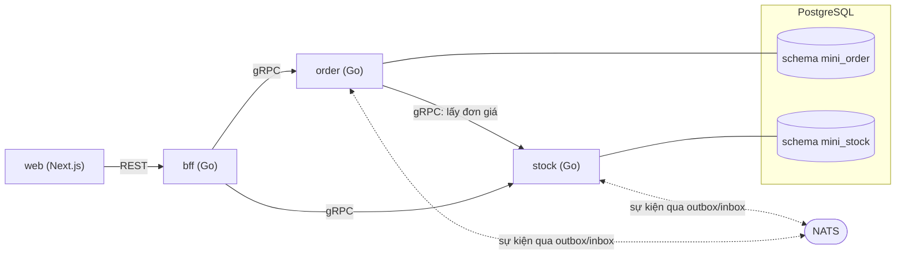

# Tech stack NEO Mini

> **Mục đích:** Mô tả kiến trúc, thành phần, cấu trúc repo và phiên bản ghim của bài NEO Mini. Đây là nơi duy nhất định nghĩa phiên bản.
>
> **Đối tượng đọc:** Người làm bài (trước ngày 1), người chấm bài.
>
> **Nguồn:** mục 3, 4.1 của đề; mục 4.4 (gói `pkg/db`), mục 10 (nhóm Hạ tầng), mục 11 (đọc thêm); quyết định Q4, Q18, Q40, Q41, Q42.

Quy tắc code, tiền, kiểm quyền: xem [conventions.md](conventions.md). Bảng và cột: xem [specs/data-model.md](specs/data-model.md). RPC và REST: xem [specs/api-contract.md](specs/api-contract.md). Sự kiện: xem [specs/events.md](specs/events.md).

## 1. Tổng quan kiến trúc

Hai microservice Go (`order`, `stock`) nói chuyện bằng gRPC và sự kiện NATS, một BFF Go, một web Next.js.

### Hướng gọi đồng bộ cho phép

| Bên gọi | Bên nhận | Giao thức | Việc |
|---|---|---|---|
| `web` | `bff` | REST | Mọi lời gọi của web |
| `bff` | `order` | gRPC | Xem [specs/api-contract.md](specs/api-contract.md) |
| `bff` | `stock` | gRPC | Xem [specs/api-contract.md](specs/api-contract.md) |
| `order` | `stock` | gRPC | Lấy đơn giá |

Chỉ có bốn hướng gọi đồng bộ này. **Stock không gọi ngược order**; việc ngược chiều đi bằng sự kiện.

### Lưu trữ và kênh sự kiện

| Thành phần | CSDL | Sự kiện qua NATS |
|---|---|---|
| `order` | PostgreSQL, schema `mini_order` | Phát và nghe (qua outbox/inbox) |
| `stock` | PostgreSQL, schema `mini_stock` | Phát và nghe (qua outbox/inbox) |
| `bff` | Không có CSDL | Không |
| `web` | Không | Không |



> **Bổ sung ngoài đề (Q18):** Một máy chủ PostgreSQL trong `deploy/compose.yaml`, hai schema `mini_order` và `mini_stock`. Sơ đồ mục 3 của đề vẽ hai khối PostgreSQL; ở đây hai khối đó được hiểu là hai schema.

## 2. Thành phần

| Thành phần | Thư mục | Vai trò |
|---|---|---|
| `order` | `services/order/` | Đơn, dòng đơn, duyệt; phát "đơn đã duyệt"; nghe kết quả giữ hàng |
| `stock` | `services/stock/` | Mặt hàng, tồn, phiếu giữ hàng; nghe "đơn đã duyệt"; phát kết quả |
| `bff` | `services/bff/` | Đổi REST/JSON sang gRPC; gắn danh tính người dùng; **không có CSDL, không tính toán** |
| Thư viện chung | `pkg/` | `tenant`, `db`, `outbox`, `inbox` (xem mục 6) |
| Hợp đồng (proto/gen) | `proto/mini/order/v1/`, `proto/mini/stock/v1/`; mã sinh ở `gen/go/` | Hợp đồng gRPC viết bằng Protobuf, sinh code bằng Buf |
| Web | `web/` | Bốn màn |
| Hạ tầng (deploy) | `deploy/compose.yaml` | PostgreSQL và NATS |

## 3. Phiên bản ghim

Ghim đúng phiên bản dưới đây.

| Hạng mục | Phiên bản | Ghi chú |
|---|---|---|
| Go | 1.27.x | |
| `github.com/jackc/pgx/v5` | v5.11.0 | |
| `google.golang.org/grpc` | v1.83.2 | |
| `github.com/nats-io/nats.go` | v1.48.0 | |
| `github.com/google/uuid` | v1.6.0 | Dùng UUIDv7 |
| goose (migration) | v3.26.0 | |
| sqlc (sinh code truy vấn) | v1.30.0 | |
| Buf (lint, sinh code proto) | v1.54.0 | |
| PostgreSQL | image `postgres:18.6` | Đề ghi `postgres:18`, ghim bản vá cụ thể (ví dụ `18.1`) nhưng không chốt số. Q4 chốt `18.6`, bản vá mới nhất của PostgreSQL 18 tại ngày 26/10/2026 (**bổ sung ngoài đề**) |
| NATS | image `nats:2.15.1-alpine3.22` | Chạy với `-js` |
| Node.js, pnpm | Node 24, pnpm 11 | |
| Next.js, React, Tailwind CSS | 16.x, 19.x, 4.x | Code ghim Next.js 16.4.3, React 19.3.1, Tailwind CSS 4.1.0 trong `web/package.json`; lockfile lưu dependency chính xác |
| `protoc-gen-go` (plugin của `buf generate`) | v1.36.11 | Cùng bản `google.golang.org/protobuf` trong `go.mod` (Q40, **bổ sung ngoài đề**) |
| `protoc-gen-go-grpc` (plugin của `buf generate`) | v1.6.2 | Q40, **bổ sung ngoài đề** |

Cài các công cụ Go đúng phiên bản (cần `$(go env GOPATH)/bin` trong `PATH`):

```bash
go install github.com/bufbuild/buf/cmd/buf@v1.54.0
go install github.com/sqlc-dev/sqlc/cmd/sqlc@v1.30.0
go install github.com/pressly/goose/v3/cmd/goose@v3.26.0
go install google.golang.org/protobuf/cmd/protoc-gen-go@v1.36.11
go install google.golang.org/grpc/cmd/protoc-gen-go-grpc@v1.6.2
```

`go mod tidy` có thể tự nâng phiên bản thư viện (ví dụ goose, grpc). Sau khi chạy, kiểm lại bằng `go list -m github.com/jackc/pgx/v5 google.golang.org/grpc github.com/nats-io/nats.go github.com/google/uuid github.com/pressly/goose/v3`; lệch thì hạ lại bằng `go get <module>@<phiên bản ghim>`.

## 4. Cấu trúc repo

Một repo, một `go.mod` ở gốc cho cả ba service Go.

```
.
├── go.mod                 một go.mod cho order, stock, bff
├── services/
│   ├── order/
│   ├── stock/
│   │   └── stocktest/     dựng service kho cho test của service khác (Q42)
│   └── bff/
├── pkg/
│   ├── tenant/
│   │   └── tenantgrpc/    interceptor metadata ↔ context (Q42)
│   ├── db/
│   ├── moneyconv/         đổi tiền chuỗi ↔ int64 xu (Q42)
│   ├── outbox/
│   └── inbox/
├── internal/
│   └── testdb/            hỗ trợ test tích hợp: tạo CSDL riêng, migrate, xóa (Q42)
├── proto/
│   └── mini/
│       ├── order/v1/
│       └── stock/v1/
├── gen/
│   └── go/                mã sinh từ proto
├── buf.yaml, buf.gen.yaml
├── web/
├── deploy/
│   ├── compose.yaml
│   └── initdb/            tạo vai trò và CSDL "mini" ở lần khởi động đầu (Q41)
├── .env.example           tên biến môi trường; .env thật không commit
└── README.md
```

`internal/testdb`, `pkg/tenant/tenantgrpc`, `pkg/moneyconv`, `services/stock/stocktest`, `deploy/initdb` là **bổ sung ngoài đề** (Q41, Q42).

Khuôn bên trong một service Go: xem [conventions.md](conventions.md), mục 1.

## 5. Hạ tầng

`deploy/compose.yaml` chạy PostgreSQL và NATS. Image lấy từ bảng ở mục 3.

| Quy tắc | Nhãn | Nguồn |
|---|---|---|
| Mọi cổng trong `compose.yaml` chỉ mở trên máy mình (`127.0.0.1`) | **BẮT BUỘC** | Mục 4.1; mục 10, Hạ tầng |
| Image ghim phiên bản | **BẮT BUỘC** | Mục 4.1; mục 10, Hạ tầng |
| `README.md` của repo có các lệnh đi từ máy trống tới lúc demo được | **BẮT BUỘC** | Mục 8 (ngày 4); mục 10, Hạ tầng |

Khai báo cổng:

```yaml
# Đúng
- "127.0.0.1:5432:5432"
# Sai
- "5432:5432"
```

## 6. Thư viện chung `pkg/`

| Gói | Vai trò |
|---|---|
| `pkg/tenant` | Đọc danh tính từ context |
| `pkg/db` | Mở giao dịch có tenant; mã nghiệp vụ chỉ mở giao dịch qua `db.InTx(ctx, func(tx pgx.Tx) error)` (quy tắc ở [conventions.md](conventions.md), mục 6) |
| `pkg/outbox` | Phần dùng chung cho mẫu outbox (mục 4.5 của đề; chi tiết ở [specs/events.md](specs/events.md)) |
| `pkg/inbox` | Phần dùng chung cho mẫu inbox (mục 4.6 của đề; chi tiết ở [specs/events.md](specs/events.md)) |

> **Gợi ý (ngoài đề):** Đề chỉ nêu tên hai gói `outbox` và `inbox`, không nói chúng chứa gì. Có thể để `pkg/outbox` giữ hàm ghi một dòng outbox trong `pgx.Tx` đang mở và vòng lặp relay, còn `pkg/inbox` giữ hàm `INSERT ... ON CONFLICT DO NOTHING` trả về "đã xử lý hay chưa".

## 7. Thêm thư viện

Muốn thêm thư viện ngoài bảng ở mục 3 thì hỏi người giao bài trước.

## 8. Đọc thêm (tùy chọn)

Danh sách link theo mục 11 của đề:

| Chủ đề | Link |
|---|---|
| PostgreSQL Row Level Security | https://www.postgresql.org/docs/current/ddl-rowsecurity.html |
| NATS JetStream | https://docs.nats.io/nats-concepts/jetstream |
| sqlc | https://docs.sqlc.dev |
| goose | https://pressly.github.io/goose/ |
| Buf | https://buf.build/docs |
| Next.js App Router | https://nextjs.org/docs/app |
