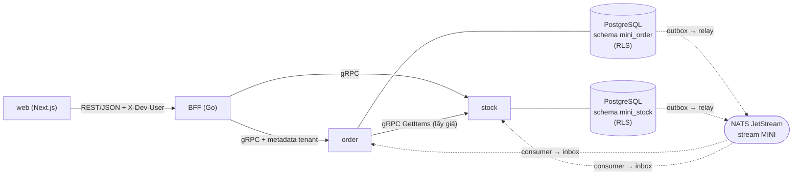
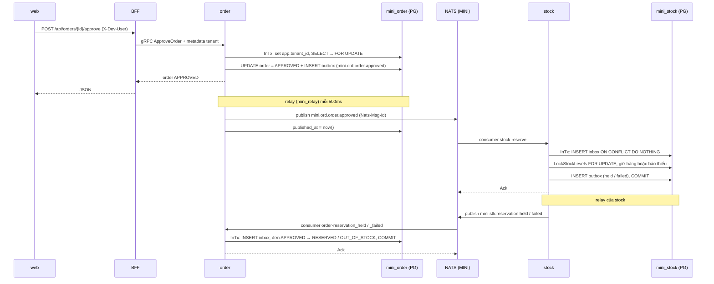

# Công nghệ trong NEO Mini: dùng ở đâu, luồng, mục đích

Tài liệu này giải thích 10 công nghệ chính của repo: **gRPC, BFF, NATS, goose, sqlc, outbox, inbox, RLS, Protobuf, buf**. Mỗi mục trả lời ba câu: dùng ở đâu (file thật trong repo), chạy theo luồng nào, và để làm gì.

Phiên bản ghim: xem [tech-stack.md](tech-stack.md), mục 3.

---

## 0. Bức tranh tổng thể



Các công nghệ chia theo lớp:

| Lớp | Công nghệ | Vai trò ngắn gọn |
|---|---|---|
| Hợp đồng API | Protobuf, buf | Định nghĩa RPC và message, sinh code Go |
| Gọi đồng bộ | gRPC, BFF | web → BFF (REST) → service (gRPC) |
| Gọi bất đồng bộ | NATS JetStream, outbox, inbox | Phát và nhận sự kiện giữa order và stock, tin cậy, không trùng |
| Dữ liệu | goose, sqlc, RLS | Migration, truy vấn type-safe, cách ly tenant ngay trong CSDL |

---

## 1. Protobuf

**Ở đâu**

- `proto/mini/order/v1/order.proto`: package `mini.order.v1`, `service OrderService` với các RPC `CreateOrder`, `GetOrder`, `ListOrders`, `ApproveOrder`, `RejectOrder`. Có message `ErrorDetail` (trường `reason`) để trả mã lỗi nghiệp vụ.
- `proto/mini/stock/v1/stock.proto`: package `mini.stock.v1`, `service StockService` với `ListItems`, `GetItems`.
- Mã sinh ra (được commit): `gen/go/mini/order/v1/{order.pb.go, order_grpc.pb.go}`, `gen/go/mini/stock/v1/{stock.pb.go, stock_grpc.pb.go}`.

**Mục đích**

- Là **hợp đồng duy nhất** giữa BFF, order, stock. Mọi bên dùng chung type Go sinh ra, nên sai tên trường hay kiểu sẽ lỗi lúc biên dịch thay vì lúc chạy.
- Có version trong tên package (`v1`) để sau này thêm `v2` mà không phá client cũ.
- BFF còn dùng `protojson` để đổi thẳng message Protobuf ↔ JSON cho web, không phải viết struct DTO riêng.

> Lưu ý: payload **sự kiện NATS không dùng Protobuf**, mà là JSON (struct `Envelope` trong `pkg/outbox/envelope.go`).

---

## 2. buf

**Ở đâu**

- `buf.yaml`: `version: v2`, module ở thư mục `proto`, `lint.use: [STANDARD]`, `breaking.use: [FILE]`.
- `buf.gen.yaml`: hai plugin local `protoc-gen-go` (v1.36.11) và `protoc-gen-go-grpc` (v1.6.2), xuất ra `gen/go` với `paths=source_relative`.

**Luồng**

```
sửa file .proto
  → buf lint             (kiểm quy tắc đặt tên, cấu trúc STANDARD)
  → buf breaking         (so với bản cũ, báo nếu phá tương thích)
  → buf generate         (gọi protoc-gen-go + protoc-gen-go-grpc)
  → gen/go/.../*.pb.go, *_grpc.pb.go
```

Lệnh nằm trong `README.md`; `run.sh` không tự chạy `buf generate` vì mã sinh đã được commit.

**Mục đích**

Thay `protoc` thủ công: một file cấu hình cho cả lint, kiểm tương thích và sinh code, ghim phiên bản plugin để mọi máy sinh ra cùng một kết quả.

---

## 3. gRPC

**Ở đâu**

| Vai trò | File | Ghi chú |
|---|---|---|
| Server order | `services/order/cmd/server/main.go` (`newServer`) | `grpc.NewServer(grpc.UnaryInterceptor(tenantgrpc.UnaryServerInterceptor()))`, `RegisterOrderServiceServer`, cổng `ORDER_GRPC_ADDR` (mặc định `127.0.0.1:50051`) |
| Server stock | `services/stock/cmd/server/main.go` | Tương tự, cổng `STOCK_GRPC_ADDR` (mặc định `127.0.0.1:50052`) |
| Handler order | `services/order/internal/adapter/grpc/server.go`, `convert.go` | Đổi request proto → usecase, lỗi domain → `status` gRPC |
| Client BFF → order, stock | `services/bff/cmd/server/main.go` | `grpc.NewClient(..., insecure)` |
| Client order → stock | `services/order/internal/adapter/stockclient/client.go` | `GetPrices` gọi `StockService.GetItems` |
| Truyền tenant | `pkg/tenant/tenantgrpc/tenantgrpc.go` | Interceptor và `OutgoingContext` |

**Luồng danh tính qua gRPC**

```
BFF: metadata.NewOutgoingContext(x-tenant-id, x-user-id, x-capabilities)
  → gRPC request
  → server: UnaryServerInterceptor đọc metadata
       thiếu/sai x-tenant-id → codes.Unauthenticated
       hợp lệ → tenant.WithIdentity(ctx, Identity{TenantID, UserID, Caps})
  → handler → usecase đọc tenant.FromContext(ctx)
```

Khi order gọi stock để lấy giá (lúc `CreateOrder`), `stockclient` bọc ctx bằng `tenantgrpc.OutgoingContext(ctx)` để chuyển tiếp nguyên danh tính của người dùng, timeout 3 giây. Giá trả về dạng chuỗi được đổi sang `int64` xu bằng `pkg/moneyconv.ToCents`.

**Mục đích**

- Gọi đồng bộ nội bộ nhanh (HTTP/2, nhị phân), có type chặt nhờ Protobuf.
- Chỉ có 4 hướng gọi đồng bộ: web→BFF (REST), BFF→order, BFF→stock, order→stock. **Stock không gọi ngược order**; chiều ngược đi bằng sự kiện NATS.

> Bảo mật: kết nối gRPC hiện **không có TLS** (`insecure.NewCredentials()`), chỉ chấp nhận được vì mọi cổng bind `127.0.0.1`.

---

## 4. BFF (Backend For Frontend)

**Ở đâu**

- `services/bff/cmd/server/main.go`: HTTP server ở `BFF_HTTP_ADDR` (mặc định `127.0.0.1:8080`), giữ hai gRPC client.
- `services/bff/internal/adapter/http/server.go`: route, middleware `authenticate`, `respond`, `decode`, `writeError`.
- `services/bff/internal/adapter/http/handlers.go`: mỗi handler gọi đúng một RPC.
- Bên web gọi BFF: `web/src/lib/data/index.ts` (`request()`), `web/src/app/actions.ts` (server action).

**Bảng route**

| REST | gRPC |
|---|---|
| `GET /api/me` | Không gọi (bảng user cục bộ) |
| `GET /api/orders` | `OrderService.ListOrders` |
| `POST /api/orders` | `OrderService.CreateOrder` |
| `GET /api/orders/{id}` | `OrderService.GetOrder` |
| `POST /api/orders/{id}/approve` | `OrderService.ApproveOrder` |
| `POST /api/orders/{id}/reject` | `OrderService.RejectOrder` |
| `GET /api/stock-items` | `StockService.ListItems` |

**Luồng một request**

```
web (server component / server action)
  đọc cookie dev_user → fetch BFF với header X-Dev-User, timeout 7s
→ BFF authenticate:
    tra X-Dev-User trong map users (an, binh, chi, dung)
    không có → 401
    có → gắn metadata gRPC x-user-id, x-tenant-id, x-capabilities, timeout 5s
→ handler: decode JSON bằng protojson (DiscardUnknown, tối đa 1 MiB) → gọi RPC
→ respond: protojson.Marshal (EmitUnpopulated)
→ lỗi: writeError đổi mã gRPC → HTTP
    InvalidArgument 400, Unauthenticated 401, PermissionDenied 403,
    NotFound 404, FailedPrecondition 409, còn lại 500
    body {code, message}; code lấy từ ErrorDetail.Reason nếu có
```

**Mục đích**

- Web chỉ cần biết REST/JSON, không phải nói gRPC.
- Một chỗ duy nhất gắn danh tính người dùng vào request trước khi vào hệ thống.
- **Không có CSDL, không tính toán nghiệp vụ**: chỉ dịch giao thức, gắn danh tính, ánh xạ lỗi.

> Bảo mật: chưa có xác thực thật. Danh tính lấy từ header `X-Dev-User` theo bảng user cứng, chỉ dùng cho môi trường dev/demo.

---

## 5. RLS (Row Level Security của PostgreSQL)

**Ở đâu**

- Vai trò: `deploy/initdb/01-roles.sh`
  - `mini_owner`: chủ bảng, chạy migration (`CREATEDB` để test tích hợp tạo CSDL riêng).
  - `mini_app`: vai trò của service, không superuser, không chủ bảng, **chịu RLS**.
  - `mini_relay`: `BYPASSRLS`, chỉ được `SELECT, UPDATE` trên bảng `outbox`.
- Policy: `services/order/migrations/00001_init.sql`, `services/stock/migrations/00001_init.sql`. Mọi bảng (`orders`, `order_lines`, `order_counters`, `stock_items`, `reservations`, `reservation_lines`, `outbox`, `inbox`) đều có:

```sql
ALTER TABLE ... ENABLE ROW LEVEL SECURITY;
ALTER TABLE ... FORCE ROW LEVEL SECURITY;   -- áp cả với chủ bảng
CREATE POLICY tenant_isolation ON ...
  USING      (tenant_id = current_setting('app.tenant_id')::uuid)
  WITH CHECK (tenant_id = current_setting('app.tenant_id')::uuid);
```

- Đặt tenant: `pkg/db/db.go`, hàm `(*DB).InTx`.

**Luồng**

```
usecase gọi db.InTx(ctx, fn)
  → tenant.FromContext(ctx); không có → ErrNoTenant
  → BEGIN (pool mini_app)
  → SELECT set_config('app.tenant_id', <tenant>, true)   -- true = chỉ trong giao dịch (như SET LOCAL)
  → fn(tx): mọi truy vấn sqlc
       SELECT/UPDATE chỉ thấy dòng của tenant (USING)
       INSERT lấy tenant_id = current_setting('app.tenant_id') và bị WITH CHECK chặn nếu sai
  → COMMIT (lỗi thì ROLLBACK)
```

Các câu `INSERT` không bao giờ nhận `tenant_id` từ Go; chúng tự lấy từ `current_setting`. Nếu quên đặt `app.tenant_id`, `current_setting` báo lỗi nên truy vấn hỏng thay vì lộ dữ liệu.

**Mục đích**

Cách ly dữ liệu giữa các tenant **ngay trong CSDL**. Dù code quên `WHERE tenant_id = ...`, người của tenant A vẫn không đọc hay ghi được dữ liệu của tenant B. Riêng relay cần đọc outbox của mọi tenant nên dùng `mini_relay` (BYPASSRLS) với quyền rất hẹp.

---

## 6. goose (migration)

**Ở đâu**

- `services/order/migrations/`: `00001_init.sql`, `00002_orders_list_index.sql`, `00003_outbox_unpublished_idx.sql`.
- `services/stock/migrations/`: `00001_init.sql`, `00002_seed.sql` (dữ liệu mẫu), `00003_outbox_unpublished_idx.sql`.
- Mỗi file có `-- +goose Up` / `-- +goose Down`.
- Chạy trong `run.sh` (hàm `migrate`) và trong `internal/testdb` cho test tích hợp.

**Luồng**

```
./run.sh
  → migrate():
      goose -dir services/order/migrations -table goose_mini_order postgres "$MIGRATE_DATABASE_URL" up
      goose -dir services/stock/migrations -table goose_mini_stock postgres "$MIGRATE_DATABASE_URL" up
  → rồi mới build và chạy stock, order, bff
```

`MIGRATE_DATABASE_URL` đăng nhập bằng `mini_owner`. Mỗi service có bảng phiên bản riêng (`goose_mini_order`, `goose_mini_stock`) nên hai bộ migration không đè lên nhau dù cùng một CSDL `mini`.

**Mục đích**

Quản lý schema có phiên bản, chạy lại được, có đường lùi (`Down`). Migration tạo bảng, bật RLS, tạo policy và `GRANT` quyền cho `mini_app`/`mini_relay`, nên cấu hình bảo mật của CSDL cũng nằm trong version control.

---

## 7. sqlc

**Ở đâu**

- Cấu hình: `services/order/sqlc.yaml`, `services/stock/sqlc.yaml` (engine `postgresql`, `schema: migrations`, `queries: queries`, `sql_package: pgx/v5`, đổi `uuid` sang `github.com/google/uuid.UUID`; order đổi thêm `timestamptz` sang `time.Time`).
- SQL viết tay:
  - order: `services/order/queries/orders.sql`, `services/order/queries/events.sql`
  - stock: `services/stock/queries/items.sql`, `services/stock/queries/events.sql`
- Code sinh: `services/{order,stock}/internal/adapter/repo/sqlcdb/`.
- Lớp bọc: `services/{order,stock}/internal/adapter/repo/*.go` gọi `sqlcdb.New(tx)`.

**Luồng**

```
viết SQL có chú thích -- name: InsertOutbox :exec
  → (cd services/order && sqlc generate)
     sqlc đọc schema từ thư mục migrations (cùng file goose dùng) + queries
  → sinh hàm Go type-safe, ví dụ sqlcdb.Queries.InsertOutbox(ctx, InsertOutboxParams{...})
  → repo gọi sqlcdb.New(tx) với tx do db.InTx mở (đã đặt tenant)
```

Một số truy vấn đáng chú ý:

| Truy vấn | Kiểu | Ý nghĩa |
|---|---|---|
| `GetOrderForUpdate` | `FOR UPDATE` | Khóa đơn khi duyệt, tránh hai người duyệt cùng lúc |
| `LockStockLevels` | `FOR UPDATE ORDER BY sku` | Khóa tồn theo thứ tự cố định, tránh deadlock |
| `ClaimOutbox` | `FOR UPDATE SKIP LOCKED` | Nhiều relay không lấy trùng dòng |
| `ClaimInbox` | `:execrows`, `ON CONFLICT DO NOTHING` | Trả 0 dòng = sự kiện đã xử lý |

**Mục đích**

Viết SQL thuần (kiểm soát được khóa, RLS, `current_setting`) mà vẫn có hàm Go đúng kiểu. Sai tên cột hay kiểu sẽ lỗi lúc `sqlc generate`, không đợi tới runtime. Vì sqlc đọc thẳng file migration của goose, schema chỉ có một nguồn.

---

## 8. NATS JetStream

**Ở đâu**

- Hạ tầng: `deploy/compose.yaml` (image `nats:2.15.1-alpine3.22`, chạy `-js`).
- Kết nối, stream, publisher: `pkg/outbox/jetstream.go`
  - `StreamName = "MINI"`, `StreamSubject = "mini.>"`.
  - `Connect`: `nats.Connect(url, Timeout 5s, MaxReconnects(-1))`, `jetstream.New`, `EnsureStream` (`CreateOrUpdateStream`).
  - `JetStreamPublisher.Publish`: `js.Publish(..., jetstream.WithMsgID(eventID))`.
- Consumer: `pkg/inbox/consumer.go` (`Subscription`).
- Nối dây: `services/order/internal/app/events.go`, `services/stock/internal/app/events.go` (`StartEvents`).

**Subject và consumer**

| Subject | Bên phát | Durable consumer | Tên consumer trong inbox | Bên nhận |
|---|---|---|---|---|
| `mini.ord.order.approved` | order | `stock-reserve` | `stock.reserve` | stock |
| `mini.stk.reservation.held` | stock | `order-reservation_held` | `order.reservation_held` | order |
| `mini.stk.reservation.failed` | stock | `order-reservation_failed` | `order.reservation_failed` | order |

Cột `type` trong bảng outbox chính là subject NATS.

**Cấu hình consumer**

- Durable, `FilterSubject` theo từng subject, `AckExplicitPolicy`, `AckWait` 30 giây.
- `PullMaxMessages(1)`: mỗi tiến trình chỉ giữ một tin, nhiều bản chạy song song thì chia nhau tin.
- Kết quả xử lý:
  - thành công (đã commit) → `Ack`
  - phong bì hỏng (`ErrMalformed`) → `Term`, không gửi lại
  - lỗi khác → `NakWithDelay(1s)`, NATS gửi lại

**Mục đích**

Kênh sự kiện **bất đồng bộ, bền** (JetStream lưu tin), để order và stock phối hợp mà không gọi trực tiếp nhau. Stock tạm chết thì tin nằm trong stream, sống lại sẽ xử lý tiếp. Header `Nats-Msg-Id` giúp JetStream bỏ tin trùng trong cửa sổ chống trùng (dùng mặc định của server). Tầng chống trùng chắc chắn nằm ở inbox.

---

## 9. Outbox pattern

**Vấn đề cần giải**

Khi duyệt đơn phải làm hai việc: cập nhật CSDL và phát sự kiện. Nếu commit xong rồi publish NATS bị lỗi thì mất sự kiện; nếu publish trước rồi commit lỗi thì phát sự kiện "ma". Outbox giải bằng cách **ghi sự kiện vào bảng trong cùng giao dịch** với dữ liệu nghiệp vụ, rồi một tiến trình riêng gửi đi sau.

**Ở đâu**

- Bảng: `mini_order.outbox`, `mini_stock.outbox` (`id` = id sự kiện UUIDv7, `tenant_id`, `type`, `payload jsonb` = cả phong bì, `created_at`, `published_at`). Migration `00003` thêm partial index `WHERE published_at IS NULL`.
- Phong bì: `pkg/outbox/envelope.go` (`Envelope`, `NewEnvelope`, `Decode`). Trường JSON: `id, type, source, tenantId, correlationId (= orderId), causationId, occurredAt, schemaVersion, data`.
- Ghi: `repo.Outbox.Add` → sqlc `InsertOutbox` (`services/{order,stock}/internal/adapter/repo/events.go`).
- Gửi: `pkg/outbox/relay.go` (`Relay.Run`, `RunOnce`, `publishAll`).

**Luồng**

```
[giao dịch nghiệp vụ, vai trò mini_app, có RLS]
  usecase cập nhật dữ liệu
  + outbox.NewEnvelope(...) → repo.Outbox.Add → INSERT INTO outbox
  COMMIT  (cả hai cùng thành công hoặc cùng hỏng)

[relay, goroutine riêng, vai trò mini_relay BYPASSRLS, mỗi 500ms]
  BEGIN
  ClaimOutbox: SELECT ... WHERE published_at IS NULL ORDER BY id LIMIT 100 FOR UPDATE SKIP LOCKED
  publishAll: gửi lần lượt theo id lên JetStream (Nats-Msg-Id = id), dừng ở tin lỗi đầu tiên để giữ thứ tự
  MarkOutboxPublished: UPDATE ... SET published_at = now() WHERE id = ANY(ids đã gửi)
  COMMIT
```

**Mục đích**

Bảo đảm **at-least-once**: đã commit là sự kiện chắc chắn được gửi. Nếu relay gửi xong mà chết trước khi commit, lần sau gửi lại; tin trùng được `Nats-Msg-Id` và inbox ở bên nhận chặn. Usecase không bao giờ gọi NATS trực tiếp.

---

## 10. Inbox pattern

**Vấn đề cần giải**

NATS có thể giao một tin nhiều lần (relay gửi lại, ack lỗi, consumer chết giữa chừng). Inbox giúp **xử lý mỗi sự kiện đúng một lần về mặt hiệu ứng**.

**Ở đâu**

- Bảng: `mini_order.inbox`, `mini_stock.inbox`, khóa chính `(tenant_id, consumer, event_id)`.
- Truy vấn: `ClaimInbox` (`INSERT ... ON CONFLICT DO NOTHING`, `:execrows`).
- Logic: `pkg/inbox/inbox.go` (`Processor.Process`), `pkg/inbox/consumer.go` (`Subscription`).
- Handler nghiệp vụ:
  - stock: `services/stock/internal/usecase/reserve.go` (`Reserver.Handle`)
  - order: `services/order/internal/usecase/events.go` (`ResultHandler.Held`, `ResultHandler.Failed`)

**Luồng (tất cả trong một giao dịch)**

```
nhận tin từ NATS
  → outbox.Decode(payload)                 hỏng → ErrMalformed → Term
  → ctx = tenant.WithIdentity(TenantID = env.tenantId, UserID = "event:<consumer>")
  → db.InTx: set_config('app.tenant_id', env.tenantId)   -- RLS áp như request thường
       ClaimInbox(consumer, event_id)
         0 dòng → đã xử lý rồi → return nil (vẫn Ack)
         1 dòng → Handle(ctx, tx, env): làm nghiệp vụ, có thể ghi outbox sự kiện kế tiếp
  → COMMIT
  → rồi mới msg.Ack()                       lỗi → NakWithDelay, NATS gửi lại
```

**Mục đích**

- Chống xử lý trùng: dòng inbox và thay đổi nghiệp vụ commit cùng lúc, nên hoặc cả hai có, hoặc cả hai không.
- Khóa có `consumer` nên một sự kiện có thể được nhiều consumer khác nhau xử lý độc lập.
- Inbox + outbox trong cùng giao dịch tạo thành chuỗi: **nhận (inbox) → xử lý → phát tiếp (outbox)** mà không mất và không trùng.

---

## 11. Ghép lại: luồng duyệt đơn từ đầu đến cuối



Từng bước, kèm công nghệ dùng:

1. **web → BFF** (REST): server action gọi `approveOrder(id)` với header `X-Dev-User`.
2. **BFF → order** (gRPC + Protobuf): `authenticate` gắn metadata tenant, handler gọi `ApproveOrder`.
3. **order nhận** (gRPC interceptor): `tenantgrpc` đặt `Identity` vào ctx.
4. **Usecase duyệt** (`decide.go`): kiểm quyền `order.approve`, mở `db.InTx` (**RLS**), khóa đơn bằng truy vấn **sqlc** `GetOrderForUpdate`, chặn tự duyệt, `o.Approve`, ghi **outbox** `mini.ord.order.approved` với data `{orderId, lines}`, lưu đơn. Tất cả trong một giao dịch.
5. **Relay của order** (**outbox** + **NATS**): gửi sự kiện lên stream `MINI`.
6. **stock nhận** (**NATS** consumer + **inbox**): ghi inbox `stock.reserve`, `Reserver.Handle` kiểm phiếu đã tồn tại chưa, khóa tồn theo SKU, giữ hàng hoặc báo thiếu, ghi **outbox** `held`/`failed` (`causationId` = id sự kiện approved). Commit rồi mới Ack.
7. **Relay của stock** gửi kết quả.
8. **order nhận kết quả** (**inbox**): `ResultHandler` chuyển đơn sang `RESERVED` hoặc `OUT_OF_STOCK`. Đơn không còn ở `APPROVED` thì bỏ qua, nhưng dòng inbox vẫn commit để lần giao lại không xử lý nữa.

Luồng đồng bộ phụ lúc **tạo đơn**: order gọi stock bằng **gRPC** `GetItems` (chuyển tiếp metadata tenant) để lấy đơn giá, stock đọc qua `db.InTx` nên cũng chịu **RLS**.

---

## 12. Thứ tự khởi động (liên quan các công nghệ trên)

`run.sh`:

1. `docker compose` (`deploy/compose.yaml`) phải đang chạy PostgreSQL và NATS; lần đầu `deploy/initdb/01-roles.sh` tạo 3 vai trò và CSDL `mini`.
2. **goose** chạy migration của order và stock bằng `mini_owner`.
3. `go build` ba service, chạy theo thứ tự stock → order → bff → web (vì order cần stock, bff cần order).

Bên trong mỗi service order/stock (`cmd/server/main.go`):

1. Đọc env (`*_DATABASE_URL` cho `mini_app`, `*_RELAY_DATABASE_URL` cho `mini_relay`, `*_GRPC_ADDR`, `NATS_URL`).
2. Mở hai pool pgx (app và relay), ping.
3. `outbox.Connect`: kết nối NATS, bảo đảm stream `MINI`.
4. (order) tạo gRPC client tới stock.
5. `app.StartEvents`: chạy goroutine relay outbox và các consumer inbox.
6. Tạo gRPC server có interceptor tenant, đăng ký service, `Serve`. Nhận SIGTERM thì `GracefulStop` và chờ relay/consumer dừng hẳn.
